**SHANDA FUEL**

**Master Product & Engineering Blueprint**

Implementation-ready logical specification • Version 1.2 • Wireframe Edition • Visual Edition

Prepared for the initial TEI Oils deployment and future multi-company commercial rollout

<table>
<colgroup>
<col style="width: 100%" />
</colgroup>
<thead>
<tr class="header">
<th>STATUS 
Architecture, domain model, state machines, UX principles, visual wireframes, architecture diagrams, core workflows and V1 scope are frozen at logical-design level. Remaining real-world values such as tank capacities, bank accounts, supplier/customer masters and opening balances are onboarding data, not development blockers.</th>
</tr>
</thead>
<tbody>
</tbody>
</table>

Business timezone: CAT / Africa/Harare • V1 currency: USD • Default shift duration: 8 hours, configurable

# **0. Document Control**

**Visual coverage in v1.2: eight architecture/process diagrams, 15 wireframe flow boards and 38 mapped V1 screens are embedded in the blueprint; the standalone V1 Wireframe Pack is the primary UX review artifact.**

| **Field**                  | **Value**                                                                                            |
|----------------------------|------------------------------------------------------------------------------------------------------|
| Document                   | Shanda Fuel Master Product & Engineering Blueprint                                                   |
| Version                    | 1.2                                                                                                  |
| Product domain             | fuel.shandahr.com                                                                                    |
| Product family             | Shanda Fuel by ShandaHR                                                                              |
| Initial operating customer | TEI Oils / Triumph Energy working identity; legal spelling to be verified at onboarding              |
| Business timezone          | CAT; stored/configured technically as Africa/Harare                                                  |
| V1 currency                | USD                                                                                                  |
| Shift default              | 8 hours; station-configurable effective-dated templates                                              |
| History migration          | No broad historical migration. Approved opening positions plus selective useful recent history only. |
| Build style                | Single-developer-friendly modular monolith with strict domain boundaries                             |
| Logical design status      | Locked; changes require explicit architecture review                                                 |

## **0.1 Source Basis**

This blueprint consolidates the client requirements summary, the locked design rounds and architecture audits, the TEI/Triumph Energy resources supplied in the project, confirmed operating assumptions, the discovery/setup workbook, and the forms we have authored for the new system.

- Primary client requirement: replace handwritten daily reconciliation and management Excel re-entry with one connected system in which stock, sales, cash, creditors, customers, profitability and reporting update from the same underlying transactions.

- Client-provided working location seed: Sandawana, Hwange, Bindura, Makaha, Kwekwe, Kadoma, Gweru, Harare, Mutare, Masvingo and Bulawayo. Each location type and production status is confirmed during onboarding rather than blocking development.

- The client expects us to learn the operating process and create the recommended forms/workflows. Missing operational master data is therefore collected through onboarding forms rather than treated as a design blocker.

## **0.2 Decision Hierarchy**

| **Priority** | **Decision source**                                                |
|--------------|--------------------------------------------------------------------|
| 1            | Confirmed client operating facts and legal/accounting sign-off     |
| 2            | Client-provided business requirements and resources                |
| 3            | Locked Shanda Fuel integrity, security and accounting invariants   |
| 4            | Recommended product defaults where no company-specific fact exists |
| 5            | Pilot tuning for thresholds and operating convenience              |

## **0.3 “Do Not Reopen Casually” Decisions**

- Multi-company SaaS and strict tenant isolation from day one.

- Separate Shanda Fuel operational database/project; future ShandaHR integration only through explicit APIs/identity integration.

- Modular monolith rather than microservices for V1 and early commercial scale.

- Authoritative balances derive from immutable domain movements, not editable balance fields or dashboard totals.

- Meter-derived quantity is canonical for ordinary forecourt sales; customer credit/prepaid/benefit records classify those sales rather than duplicating litres.

- Cash custody, bank money and provider settlement balances are separate domains.

- Supplier invoice quantity/commercial claim cannot rewrite physical delivery quantity.

- Tank dips are physical observations and do not silently adjust book inventory.

- Posted/locked business facts are corrected through reversal, compensation or approved adjustment rather than delete/edit.

# **1. Executive Product Definition**

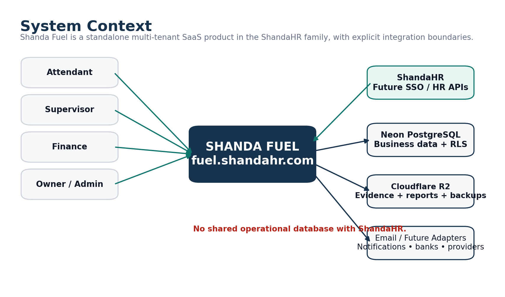

*Figure 1. System context and external boundaries.*

Shanda Fuel is a mobile-first service-station operations, reconciliation and management platform designed initially for TEI Oils and architected for commercial use by fuel-station businesses across Zimbabwe and Africa. The product connects the physical forecourt to inventory, cash custody, electronic settlements, suppliers, customer accounts, expenses, profitability, approvals, evidence and management reporting.

<table>
<colgroup>
<col style="width: 100%" />
</colgroup>
<thead>
<tr class="header">
<th>
<strong>PRODUCT PROMISE</strong>

Enter operational information once, preserve physical and financial truth separately where necessary, approve it through explicit workflows, and use the same authoritative data for stock, cash, creditor/debtor, profitability and management reporting.
</th>
</tr>
</thead>
<tbody>
</tbody>
</table>

## **1.1 Business Outcomes**

| **Outcome**                       | **How Shanda Fuel achieves it**                                                                                                      |
|-----------------------------------|--------------------------------------------------------------------------------------------------------------------------------------|
| Remove paper-to-Excel duplication | Guided mobile workflows feed the same database used by management reports and exports.                                               |
| Improve daily control             | Meter, payment, cash, tank and delivery variances are calculated automatically and surfaced exception-first.                         |
| Know where money is               | Cash custody follows station → transit/collector → deposit pending → bank confirmation; POS/EcoCash stays separate until settlement. |
| Know true stock and cost          | Inventory pool ledger records receipt, sale, transfer, adjustment and revaluation quantities/values with moving WAC.                 |
| Control credit and suppliers      | Supplier and customer ledgers, allocations, aging, limits and approvals are explicit.                                                |
| Get trustworthy profit            | Revenue, COGS, operating expenses and fixed-cost recognition come from canonical movements and calculation logic.                    |
| Prepare for scale                 | Tenant-aware schema, granular permissions, reproducible reports, jobs, audit and onboarding are designed from day one.               |

## **1.2 Product Principles**

- Simple by default. Powerful when needed. Explicit when risky.

- Physical occurrence, commercial paperwork and financial recognition may happen at different times; none is silently erased to make numbers look neat.

- One dominant action per screen where practical; normal matching data stays quiet and exceptions get attention.

- Official state changes occur through named commands and state machines, never arbitrary status updates.

- The owner has highest business authority but is not an integrity/security bypass.

## **1.3 V1 Scope**

| **Area**       | **V1 coverage**                                                                                                                       |
|----------------|---------------------------------------------------------------------------------------------------------------------------------------|
| Access & setup | Tenant, legal entity, stations, users, roles, permissions, products, shifts, pumps/nozzles/meters, tanks, prices and payment channels |
| Forecourt      | Business day, shift, opening/closing meter boundaries, attendant handover, meter segments and expected sales                          |
| Reconciliation | Attendant declarations, supervisor reconciliation, variance explanations, management approval, posting and lock                       |
| Inventory      | Inventory pools, deliveries, dips/calibration, WAC costing, adjustments, transfers structure, revaluation                             |
| Money          | Cash custody/counts/handovers/collections/deposits, bank tracking, POS/EcoCash/provider settlement                                    |
| Suppliers      | Invoices, due dates, unbilled exposure, credit notes, payments, allocations, aging/statements                                         |
| Customers      | Credit, prepaid value, prepaid litres, benefit, vehicle/driver controls, authorizations, payments, billing                            |
| Expenses       | Daily expense workflows, cash/bank/payable effects, recurring/fixed cost recognition                                                  |
| Management     | Profitability, operational financial position, Action Center, curated reports, PDF/XLSX exports, audit                                |

## **1.4 Explicit V1 Non-Goals**

- No full general ledger or statutory accounting suite.

- No invented tax engine before accountant confirmation of applicable treatment and invoice requirements.

- No microservices, event-bus platform or premature warehouse/BI stack.

- No unrestricted offline financial posting; offline support is for limited drafts only.

- No OCR/AI posting of receipts/invoices in V1; upload + manual structured entry is safer and cheaper.

- No direct bank integration required for V1; bank confirmation can be manual and auditable.

# **2. Users, Roles & Experience**

## **2.1 Role Model**

| **Role**      | **Primary responsibility**                                                                        | **Default scope**               |
|---------------|---------------------------------------------------------------------------------------------------|---------------------------------|
| Owner         | Business authority, high-risk approvals, company-wide management and configuration                | Tenant / legal entity           |
| Administrator | Operational administration, users/configuration according to granted permissions                  | Tenant / legal entity / station |
| Finance       | Suppliers, deposits, settlements, customers, expenses and financial reporting                     | Tenant / legal entity           |
| Supervisor    | Operate station day/shift, meters, deliveries, dips, cash, expenses and reconciliation submission | Station                         |
| Attendant     | Assigned shift/nozzle work, account fuel and payment declaration                                  | Station / shift / nozzle        |

## **2.2 Permission Architecture**

Role names are convenience templates; granular permission codes and scope are authoritative. A user may hold different scoped roles in different stations or legal entities. Temporary elevated grants are expiring and audited.

<table>
<colgroup>
<col style="width: 100%" />
</colgroup>
<thead>
<tr class="header">
<th>Tenant Membership 
├─ Role Assignment (TENANT / LEGAL_ENTITY / STATION) 
├─ Role → Permission Codes 
└─ Temporary Permission Grant (scoped + expires)</th>
</tr>
</thead>
<tbody>
</tbody>
</table>

- Self-approval is prohibited by default.

- Sensitive exports have separate view/export permissions.

- Owner/Admin/Finance/Supervisor strong authentication is required by default; final rollout practicality can be tuned without weakening core controls.

- Users are disabled, not deleted, after they have business history.

## **2.3 Navigation & Device Strategy**

| **Experience**           | **Primary navigation**      | **Design emphasis**                                                        |
|--------------------------|-----------------------------|----------------------------------------------------------------------------|
| Attendant mobile         | Home / Tasks / Work / More  | Fast, minimal, assignment-focused; no management complexity                |
| Supervisor mobile/tablet | Today / Tasks / Work / More | Station operations, progress, exceptions, sticky next action               |
| Finance desktop/tablet   | Sidebar + Action Center     | Queue processing, allocations, reconciliation, drill-down and exports      |
| Owner desktop/mobile     | Business health + approvals | Exception-first overview, consequence-aware approvals, explainable metrics |

## **2.4 UX Invariants**

- Mobile operational workflows are first-class; desktop is not simply shrunk onto a phone.

- No giant Excel-style daily form in the app. Complex processes are broken into real operational steps.

- At least 44px-equivalent touch targets; persistent labels; tabular numerals for financial values; status never conveyed by colour alone.

- Posted records display View / Audit / Request Reversal, not normal Edit / Delete.

- Authoritative actions only show success after server confirmation.

- Weak connection state and local drafts are truthful and visible.

## **2.5 Critical User Journeys**

| **Journey**    | **Happy path**                                                                                                                                           |
|----------------|----------------------------------------------------------------------------------------------------------------------------------------------------------|
| Supervisor day | Open business day → start shift → confirm meters/team → operate/deliver/expense/cash → meter close → complete operations → reconcile exceptions → submit |
| Attendant      | View assignment → record authorized account fuel when needed → submit payment declaration → hand over nozzle if needed                                   |
| Finance        | Review Action Center → record/approve creditor/customer/bank/provider work → resolve exceptions → export/report                                          |
| Owner          | Open business health → review high-severity items → inspect consequences/evidence → approve/return → review cash/stock/profit                            |

## 2.6 V1 Mid-Fidelity Wireframes

The previous conceptual UI gallery has been replaced. The screens below are mid-fidelity wireframes showing actual navigation, field hierarchy, primary actions, exception states and role-specific behavior. The complete embedded pack is in Appendix F; the standalone Wireframe Pack v1.2 is the easiest UX review artifact.

Supervisor start-shift flow.

Guided delivery receipt flow.

Finance queue-based desktop workflow.

# **3. Operating Model & Master Data**

## **3.1 Hierarchy**

<table>
<colgroup>
<col style="width: 100%" />
</colgroup>
<thead>
<tr class="header">
<th>PLATFORM 
└─ TENANT 
└─ LEGAL ENTITY 
└─ STATION 
├─ Business Days / Shifts 
├─ Pumps / Nozzles / Meter Installations 
├─ Tanks / Calibration / Dips 
├─ Inventory Pools 
├─ Cash Locations 
└─ Payment Channels</th>
</tr>
</thead>
<tbody>
</tbody>
</table>

The system is multi-company from day one. Tenant-owned tables carry tenant_id and tenant-aware foreign keys; application authorization is backed by PostgreSQL row-level security.

## **3.2 Confirmed / Recommended Operating Defaults**

| **Setting**              | **Current blueprint value**                                                   | **Change method**                                          |
|--------------------------|-------------------------------------------------------------------------------|------------------------------------------------------------|
| Business timezone        | CAT; technical IANA zone Africa/Harare                                        | Tenant/station configuration                               |
| Currency                 | USD for V1                                                                    | Currency-aware schema supports future additions            |
| Products                 | Diesel and Petrol seeded                                                      | Configurable product master                                |
| Shift length             | 8 hours by default                                                            | Effective-dated station shift templates                    |
| Shift clock times        | Starter 00:00–08:00 / 08:00–16:00 / 16:00–00:00 only; not assumed TEI reality | Set during station onboarding                              |
| History migration        | No broad migration                                                            | Opening positions + selective useful recent closed history |
| Cash unbanked warning    | 24h warning / 48h urgent pilot default                                        | Effective policy configuration                             |
| Manual bank confirmation | Enabled in V1                                                                 | Future integration adapter                                 |

## **3.3 Working Location Seed**

The following locations are seeded from the client-provided Triumph Energy resource. The software does not assume every entry is a retail station until onboarding confirms its type and active status.

| **Location** | **Onboarding status**                                    |
|--------------|----------------------------------------------------------|
| Sandawana    | Type / active state to confirm; eligible pilot candidate |
| Hwange       | Type / active state to confirm; eligible pilot candidate |
| Bindura      | Type / active state to confirm; eligible pilot candidate |
| Makaha       | Type / active state to confirm; eligible pilot candidate |
| Kwekwe       | Type / active state to confirm; eligible pilot candidate |
| Kadoma       | Type / active state to confirm; eligible pilot candidate |
| Gweru        | Type / active state to confirm; eligible pilot candidate |
| Harare       | Type / active state to confirm; eligible pilot candidate |
| Mutare       | Type / active state to confirm; eligible pilot candidate |
| Masvingo     | Type / active state to confirm; eligible pilot candidate |
| Bulawayo     | Type / active state to confirm; eligible pilot candidate |

## **3.4 Effective-Dated Configuration**

Critical configuration is versioned and effective-dated so that current settings never rewrite history. Examples include selling prices, shift templates, tank/nozzle configuration, calibration charts, customer account policies, supplier terms, recurring costs, approval policies and station cash floats.

<table>
<colgroup>
<col style="width: 100%" />
</colgroup>
<thead>
<tr class="header">
<th>
<strong>RULE</strong>

Configuration may make workflows more or less strict, but it cannot disable tenant isolation, ledger conservation, immutable posting, authorization checks, or other integrity invariants.
</th>
</tr>
</thead>
<tbody>
</tbody>
</table>

# **4. Source-of-Truth & Financial Integrity Model**

## **4.1 Four Layers of Truth**

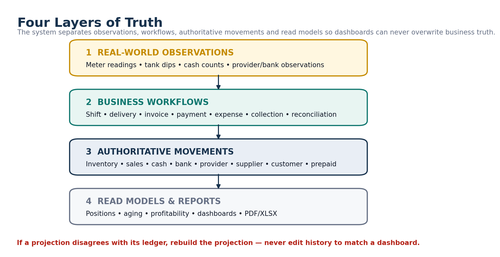

*Figure 2. Four layers of truth: observations, workflows, authoritative movements, and read models.*

| **Layer**               | **Examples**                                                                           | **Rule**                                                                     |
|-------------------------|----------------------------------------------------------------------------------------|------------------------------------------------------------------------------|
| Physical observations   | Meter reading, tank dip, cash count, provider/bank observation                         | Record what was observed; do not automatically rewrite financial/book truth. |
| Business workflows      | Shift, delivery, invoice, payment, expense, collection, reconciliation                 | Represent authorization and state progression.                               |
| Authoritative movements | Inventory, sales recognition, cash, bank, provider, supplier, customer/prepaid ledgers | Immutable after posting; corrections are compensating movements.             |
| Projections & reports   | Stock position, cash position, aging, profitability, Action Center                     | Rebuildable; never override authoritative history.                           |

## **4.2 Canonical Ledgers**

| **Domain**          | **Authoritative movement source**          | **Projection / report examples**          |
|---------------------|--------------------------------------------|-------------------------------------------|
| Inventory           | inventory_movement + inventory_revaluation | Inventory pool state, stock reports, COGS |
| Official revenue    | sale_recognition_movement                  | Revenue/profitability                     |
| Physical cash       | cash_movement                              | Cash position / custody aging             |
| Tracked bank money  | bank_movement                              | Tracked bank position                     |
| Electronic provider | provider_account_movement                  | Provider outstanding / settlement         |
| Supplier creditor   | supplier_account_movement                  | Payables, aging, statements               |
| Customer credit     | customer_credit_movement                   | Receivables, exposure, aging              |
| Prepaid value       | prepaid_value_movement                     | Available prepaid value                   |
| Prepaid litres      | prepaid_litre_movement                     | Product-specific litre balance            |
| Expenses            | posted expense + recurring recognition     | Operating/fixed cost reporting            |

## **4.3 Universal Conservation Rules**

- Internal cash transfer movements sum to zero across source/transit/destination/dispute custody.

- A customer fuel transaction cannot claim more ordinary forecourt fuel than supported by meter segments within the relevant operational scope.

- Payment/credit allocations cannot exceed the source payment/credit capacity.

- Prepaid balances do not silently go below zero.

- Inventory quantity cannot go negative through normal operational commands.

- Provider outstanding equals sales receivable minus refunds/reversals/fees/settlements plus approved adjustments.

- Recurring-cost payment settles an obligation; it does not create another expense recognition.

## **4.4 Time Model**

| **Field / concept** | **Meaning**                                                                                          |
|---------------------|------------------------------------------------------------------------------------------------------|
| business_date       | Operational reporting date, independent of UTC timestamp. Overnight shift belongs to its start date. |
| effective_at        | When an economic/operational fact applies.                                                           |
| posted_at           | When Shanda officially recognized/posted that fact.                                                  |
| as_of               | Report cutoff for what had been posted/known by a specific time.                                     |

Official historical reports use period/effective criteria plus posted_at \<= as_of, allowing later corrections/restatements without silently altering what a prior report represented.

# **5. Forecourt, Shift & Meter Operations**

## **5.1 Station Business Day**

<table>
<colgroup>
<col style="width: 100%" />
</colgroup>
<thead>
<tr class="header">
<th>NOT_STARTED 
└─ OpenBusinessDay → OPEN 
OPEN 
├─ MarkOperationsComplete → OPERATIONS_COMPLETE → FinalizeOperations → CLOSED 
└─ ExceptionalCloseBusinessDay → EXCEPTIONALLY_CLOSED</th>
</tr>
</thead>
<tbody>
</tbody>
</table>

Multiple unfinished business days may exist if operations span administrative boundaries, but physical nozzle exclusivity is enforced so two active processes cannot own the same nozzle at the same time.

## **5.2 Shift State Machine**

<table>
<colgroup>
<col style="width: 100%" />
</colgroup>
<thead>
<tr class="header">
<th>PLANNED 
├─ StartShift → OPEN 
├─ MarkNotOperated → NOT_OPERATED 
└─ CancelBeforeStart → CANCELLED_BEFORE_START 
OPEN 
├─ CloseMeters → METER_CLOSED → CompleteShift → COMPLETED 
└─ ExceptionalClose → EXCEPTIONALLY_CLOSED</th>
</tr>
</thead>
<tbody>
</tbody>
</table>

## **5.3 Meter Boundaries & Segments**

One generalized boundary system handles shift open/close, attendant handover, price change, delivery, meter reset/replacement and correction. A meter segment is the interval between two confirmed boundaries under one price/configuration/attendant context.

| **Boundary reason**       | **Effect**                                                                                         |
|---------------------------|----------------------------------------------------------------------------------------------------|
| SHIFT_OPEN / SHIFT_CLOSE  | Defines shift meter responsibility                                                                 |
| ATTENDANT_HANDOVER        | Ends one attendant assignment and begins the next at the same physical reading                     |
| PRICE_CHANGE              | Closes old-price segment before new price activates                                                |
| DELIVERY                  | Creates a clean chronology boundary around inventory receipt/WAC change where dispensing is paused |
| METER_RESET / REPLACEMENT | Prevents false negative litres while preserving physical device history                            |
| CORRECTION                | Controlled pre-lock correction; after lock a compensating correction event is used                 |

## **5.4 Forecourt Calculation Rules**

| **Calculation**             | **Rule**                                                                                               |
|-----------------------------|--------------------------------------------------------------------------------------------------------|
| Litres sold                 | Confirmed end meter reading - confirmed start meter reading, except controlled reset/replacement paths |
| Expected sale value         | Segment litres × effective station/product selling price version                                       |
| Operational inventory issue | Created when the meter segment is sealed so stock chronology remains correct                           |
| Financial revenue posting   | Created later when the approved daily reconciliation posts; inventory is not consumed twice            |

## **5.5 Price Change**

<table>
<colgroup>
<col style="width: 100%" />
</colgroup>
<thead>
<tr class="header">
<th>DRAFT → PENDING_APPROVAL → APPROVED → SCHEDULED 
→ PENDING_STATION_ACTIVATION → BOUNDARIES_IN_PROGRESS → ACTIVE 
\-- FAILED_ACTIVATION / CANCELLED</th>
</tr>
</thead>
<tbody>
</tbody>
</table>

During an active shift, the old server-confirmed price remains authoritative until all required affected-nozzle boundaries are captured and the server activates the new price.

# **6. Daily Reconciliation & Official Sales Posting**

## **6.1 Purpose**

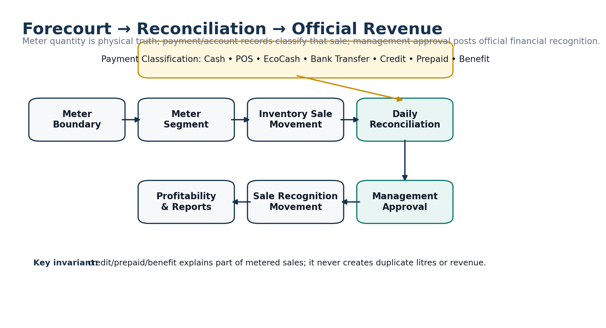

*Figure 3. Forecourt quantity and payment classification flow into approved official revenue recognition.*

Daily reconciliation converts the physical forecourt and operational declarations into an approved financial classification of the business day. The supervisor does not re-enter all information; the system builds the reconciliation from accepted meter segments, declarations and explicit customer/payment transactions and emphasizes only differences or missing items.

## **6.2 Reconciliation State Machine**

<table>
<colgroup>
<col style="width: 100%" />
</colgroup>
<thead>
<tr class="header">
<th>DRAFT → READY → SUBMITTED → PENDING_APPROVAL 
├─ Return → RETURNED → corrected READY → new revision 
├─ Reject → REJECTED 
└─ Approve → APPROVED → POSTED → LOCKED</th>
</tr>
</thead>
<tbody>
</tbody>
</table>

Each submission creates an immutable reconciliation revision. Approval applies to one exact revision; edits or resubmission supersede the old approval request.

## **6.3 Payment Classification**

| **Component**              | **Source**                                                                    |
|----------------------------|-------------------------------------------------------------------------------|
| Cash                       | Accepted cash declarations and known system cash transactions                 |
| POS / EcoCash / electronic | Accepted declaration + payment channel/provider records                       |
| Bank transfer              | Explicit electronic/bank-classified sale records                              |
| Customer credit            | Customer fuel transaction linked to account authorization and meter context   |
| Prepaid value              | Customer fuel transaction + prepaid value draw                                |
| Prepaid litres             | Customer fuel transaction + product-specific litre draw                       |
| Benefit / internal         | Fuel transaction classified as benefit/internal use with reconciliation value |

## **6.4 Variance**

<table>
<colgroup>
<col style="width: 100%" />
</colgroup>
<thead>
<tr class="header">
<th>
<strong>CANONICAL INTERPRETATION</strong>

Reconciliation variance = accounted/classified sale value - meter-derived expected sale value. Threshold policy determines whether the difference is informational, requires explanation, or blocks normal submission/approval.
</th>
</tr>
</thead>
<tbody>
</tbody>
</table>

## **6.5 Sale Recognition**

When reconciliation posts, Shanda creates official sale_recognition movements by meter segment and classification. Customer account fuel is not added on top of meter sales; it explains which portion of the meter-derived value was credit, prepaid, benefit or other classification.

| **Stored value**          | **Reason**                                                                    |
|---------------------------|-------------------------------------------------------------------------------|
| quantity_litres           | Trace official financial classification back to physical fuel                 |
| reconciliation_value      | Value needed to make station fuel accountability balance                      |
| recognized_revenue_amount | Actual financial revenue classification; may differ for internal/benefit fuel |

# **7. Inventory, Tanks, Deliveries & Costing**

## **7.1 Physical Tank vs Book Inventory**

| **Concept**              | **Authoritative source**                                                                                                     |
|--------------------------|------------------------------------------------------------------------------------------------------------------------------|
| Physical volume estimate | Tank dip converted using the exact effective calibration version                                                             |
| Book quantity/value      | Inventory pool movement ledger                                                                                               |
| Available stock          | Book stock adjusted for quarantine/reservations as applicable; physical overage never increases official stock automatically |
| Variance                 | Physical estimate - book quantity; becomes an exception until resolved/adjusted                                              |

## **7.2 Inventory Pool Model**

Book stock is held at Inventory Pool/Supply Group level rather than blindly by tank because manifolded tanks can feed the same product/nozzles. Tanks preserve physical observations; pools preserve book quantity/value and moving WAC.

## **7.3 Delivery State Machine**

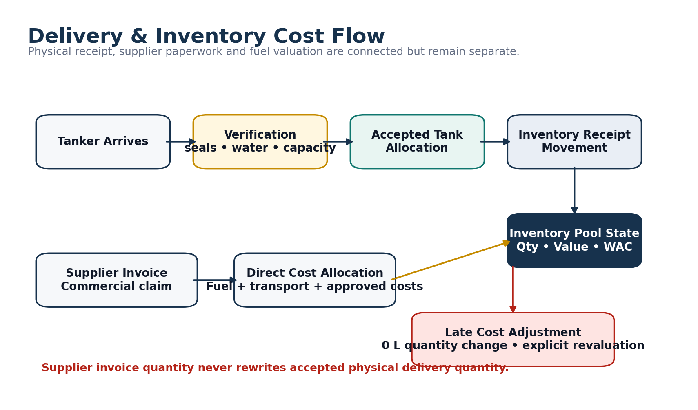

*Figure 4. Physical delivery, inventory posting, supplier cost allocation and late-cost revaluation.*

<table>
<colgroup>
<col style="width: 100%" />
</colgroup>
<thead>
<tr class="header">
<th>DRAFT → ARRIVED → VERIFICATION → OFFLOADING 
├─ OFFLOADING_INTERRUPTED → resume / partial receipt 
└─ RECEIVED_PENDING_CONFIRMATION → CONFIRMED → POSTED 
Pre-offload failure → REJECTED Unstarted → CANCELLED Posted correction → reversal workflow</th>
</tr>
</thead>
<tbody>
</tbody>
</table>

## **7.4 Delivery Invariants**

- Physical accepted quantity is derived from accepted tank allocations at the lowest meaningful level, not from the supplier invoice.

- Delivery-note quantity remains the commercial claim and is compared with actual accepted quantity; shortage/excess is never hidden.

- Pre/post dip, seal, water test and capacity checks are structured verification facts; policy decides which are mandatory.

- Default V1 operating mode pauses affected product dispensing during offload where operationally possible, giving clean cost chronology.

- Wrong-product/unsafe receipt quarantines affected stock rather than pretending the delivery did not occur.

## **7.5 Moving Weighted Average Cost**

Receipts add quantity and landed value to the inventory pool. The new WAC is computed transactionally from existing pool value/quantity plus the receipt. Selling price is entirely separate from cost.

| **Case**                   | **Treatment**                                                                              |
|----------------------------|--------------------------------------------------------------------------------------------|
| Normal receipt             | \+ quantity, + landed value; WAC recalculates                                              |
| Sale                       | \- quantity, - value at chronological WAC snapshot                                         |
| Late transport/direct cost | 0 quantity revaluation plus split between remaining inventory and previously consumed COGS |
| Transfer                   | Source WAC carried to destination; approved direct transfer cost added explicitly          |
| Stock adjustment           | Approved signed movement with reason; normal negative stock prohibited                     |

# **8. Suppliers, Customers & Expenses**

## **8.1 Supplier / Creditor Model**

Physical delivery, supplier invoice, supplier account movement and supplier payment are separate objects. This prevents commercial paperwork from rewriting physical stock and supports unbilled fuel exposure when fuel arrives before the invoice.

| **Capability**     | **Design**                                                                                                                   |
|--------------------|------------------------------------------------------------------------------------------------------------------------------|
| Supplier invoices  | Versioned workflow with due date/terms snapshot, duplicate control and supporting documents                                  |
| Unbilled exposure  | Posted delivery quantity/value not yet covered by posted supplier invoice allocations                                        |
| Payments           | Many-to-many payment ↔ invoice allocations; partial payments and unapplied prepayments supported                             |
| Credit notes       | Append-only commercial reduction; paid invoices can result in unapplied supplier credit rather than negative invoice balance |
| Statements / aging | Movement/allocation-derived as-of reporting                                                                                  |

## **8.2 Customer Account Types**

| **Type**       | **Canonical balance / control**                                      |
|----------------|----------------------------------------------------------------------|
| CREDIT         | Receivable ledger + credit limit + reservations + billing mode/terms |
| PREPAID_VALUE  | Currency-denominated stored value; no silent negative balance        |
| PREPAID_LITRES | Product-specific litre balance keyed by account + product            |
| BENEFIT        | Allowance/classification policy for approved non-cash/internal fuel  |

## **8.3 Customer Fuel Authorization**

<table>
<colgroup>
<col style="width: 100%" />
</colgroup>
<thead>
<tr class="header">
<th>REQUESTED → AUTHORIZED / RESERVED → PARTIALLY_USED → COMPLETED 
├─ CANCELLED 
└─ EXPIRED 
Policy failure → REJECTED Limit override → explicit approval request before over-limit reservation</th>
</tr>
</thead>
<tbody>
</tbody>
</table>

Reservations lock exposure/prepaid capacity transactionally so two attendants cannot both spend the same remaining credit or prepaid balance.

## **8.4 Billing & Payments**

- Credit fuel creates receivable immediately; billing documents can be immediate/daily/weekly/monthly without creating the debt twice.

- Customer payments may allocate across invoices; excess remains explicit unapplied credit unless refunded.

- Cash customer payment atomically reduces receivable and increases physical cash custody.

- Customer-specific pricing, station/product/vehicle/driver restrictions and policy versions are snapshotted for historical explainability.

## **8.5 Expenses & Recurring Costs**

| **Area**                   | **Rule**                                                                                                                       |
|----------------------------|--------------------------------------------------------------------------------------------------------------------------------|
| Daily expense              | Economic expense document plus separate settlement source (cash/bank/payable/reimbursement)                                    |
| Cash paid before approval  | Cash movement remains physical truth even if later expense approval fails; a resolution exception handles the business problem |
| Direct inventory cost      | Classified separately so landed cost is not deducted twice as operating expense                                                |
| Recurring fixed cost       | Template → period obligation → daily recognition → payment allocation                                                          |
| Payroll future integration | ShandaHR remains authoritative; Fuel receives explicit API data and prevents duplicate manual recognition                      |

# **9. Cash, Banking & Electronic Settlements**

## **9.1 Cash Custody**

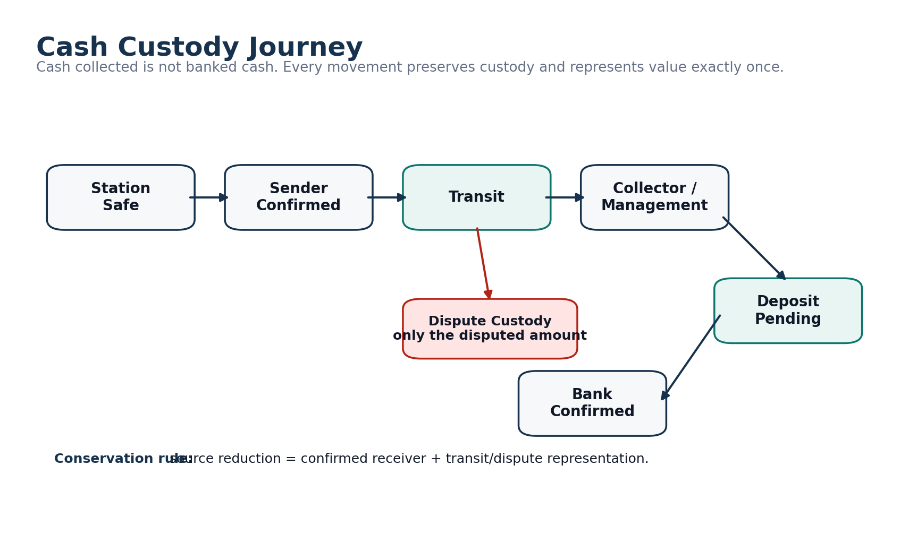

*Figure 5. Cash custody from station safe to bank confirmation, including transit and dispute custody.*

Physical cash is tracked by location, custodian and currency. Internal handovers conserve value and use explicit transit/dispute custody so the same cash is never simultaneously counted at two locations.

<table>
<colgroup>
<col style="width: 100%" />
</colgroup>
<thead>
<tr class="header">
<th>Station Safe 
└─ Sender confirmation → Handover Transit 
├─ Receiver agrees → Collector / Management Custody 
└─ Receiver differs → Acknowledged Custody + Dispute Custody 
└─ Deposit Recorded → Deposit Pending → Bank Confirmed</th>
</tr>
</thead>
<tbody>
</tbody>
</table>

## **9.2 Expected Physical Cash**

<table>
<colgroup>
<col style="width: 100%" />
</colgroup>
<thead>
<tr class="header">
<th>
<strong>FORMULA</strong>

Expected physical cash = opening physical cash + cash receipts - cash disbursements - confirmed collections ± approved cash adjustments. “Cash sales” and “cash receipts” are not interchangeable because customer debt payments/prepaid top-ups can add cash without being same-day fuel sales.
</th>
</tr>
</thead>
<tbody>
</tbody>
</table>

## **9.3 Banking**

- Bank account master data is sensitive; high-risk changes require step-up authentication and approval.

- A recorded deposit is not automatically confirmed bank money. Deposit pending and bank-confirmed stages are separate.

- V1 can use manual bank confirmation by Finance/Owner. Future statement adapters fit the existing model without changing cash custody logic.

- Tracked bank balance is only as complete as imported/confirmed bank movements; reports disclose completeness rather than claiming a true bank statement balance without evidence.

## **9.4 POS / EcoCash / Provider Settlement**

<table>
<colgroup>
<col style="width: 100%" />
</colgroup>
<thead>
<tr class="header">
<th>Station Declaration 
→ Provider Receivable 
→ Provider Batch / Statement 
→ Fees / refunds / reversals 
→ Settlement 
→ Bank Receipt 
→ Difference? resolve via exception, not station-shortage rewrite</th>
</tr>
</thead>
<tbody>
</tbody>
</table>

| **Metric**              | **Definition**                                                              |
|-------------------------|-----------------------------------------------------------------------------|
| Expected net settlement | Gross provider sales - refunds/reversals - provider charges                 |
| Settlement variance     | Actual bank settlement - expected net settlement                            |
| Provider fee            | Expense + provider account reduction; never unexplained cash/sales shortage |

# **10. Profitability, Operational Position & Reporting**

## **10.1 Profitability**

| **Metric**            | **Canonical source / formula**                                      |
|-----------------------|---------------------------------------------------------------------|
| Revenue               | Posted sale recognition movements                                   |
| COGS                  | Inventory sale movement value plus explicit later COGS revaluations |
| Gross Profit          | Revenue - COGS                                                      |
| Gross Profit / L      | Gross Profit ÷ applicable litres                                    |
| Operating Expenses    | Posted operating expense recognition                                |
| Fixed-cost allocation | Recurring cost daily recognition                                    |
| Operational Profit    | Gross Profit - operating expenses - fixed-cost recognition          |

<table>
<colgroup>
<col style="width: 100%" />
</colgroup>
<thead>
<tr class="header">
<th>
<strong>BOUNDARY</strong>

Operational Profit is a management measure, not statutory net profit. Tax, financing, depreciation and a full general ledger are outside the confirmed V1 scope unless explicitly added later.
</th>
</tr>
</thead>
<tbody>
</tbody>
</table>

## **10.2 Shanda Operational Net Position**

| **Assets / exposures**          | **Liabilities / obligations**                              |
|---------------------------------|------------------------------------------------------------|
| Physical cash custody           | Supplier payable                                           |
| Tracked bank money              | Approved unbilled supplier exposure                        |
| Electronic provider receivables | Operating/unpaid expense obligations                       |
| Customer receivables            | Customer prepaid-value obligation                          |
| Inventory value                 | Prepaid-litre estimated exposure / obligation presentation |

This is explicitly labeled “Shanda Operational Net Position”, not a statutory balance sheet.

## **10.3 Reporting States**

| **State**        | **Meaning**                                                                                            |
|------------------|--------------------------------------------------------------------------------------------------------|
| LIVE / ESTIMATED | Current operational data including pending/provisional components, visibly labeled                     |
| POSTED           | Official posted data only                                                                              |
| RESTATED         | Later approved adjustments/revaluations changed the as-of result; prior report artifacts remain intact |

## **10.4 Curated Report Catalogue**

| **Category** | **Initial reports**                                                                    |
|--------------|----------------------------------------------------------------------------------------|
| Operations   | Daily Reconciliation, Shift Sales, sales by station/product/attendant/payment          |
| Inventory    | Stock Position, Movement History, Tank Dip History, Stock Variance, Delivery Variance  |
| Money        | Cash Custody, Collections/Banking, POS/EcoCash Settlement                              |
| Commercial   | Supplier Aging/Statement/Payments, Customer Aging/Statement/Payments                   |
| Financial    | Daily/Station Profitability, Operational Financial Position, expenses/fixed-cost views |

## **10.5 Export Integrity**

- Dashboard, PDF and XLSX use the same canonical calculation layer.

- Report Run stores period, as_of, filters, calculation version, data-quality status and source cutoff/checksum.

- Report Artifact is separate from Report Run; multiple PDF/XLSX artifacts may belong to one run.

- Large exports are background jobs in private storage with short-lived download links and authorization rechecks at request, generation and download.

# **11. Approvals, Exceptions, Documents & Audit**

## **11.1 Approval Engine**

Approval policy is effective-dated and snapshotted at submission. Current security authority is not snapshotted; it is always rechecked when a user attempts to approve.

| **Concept**           | **Rule**                                                                                |
|-----------------------|-----------------------------------------------------------------------------------------|
| Approval Request      | Links to exact business record version                                                  |
| Approval Step         | Required permission, scope and approver count                                           |
| Decision              | Approve / Reject / Return for Correction with actor/time/scope snapshot                 |
| Superseded            | If source record changes, pending old approval becomes SUPERSEDED and cannot be reused  |
| Single Authority Mode | Audited configurable exception for genuine one-owner situations, never a generic bypass |

## **11.2 Recommended Pilot Approval Defaults**

| **Domain**                             | **Recommended default**                                                                                                |
|----------------------------------------|------------------------------------------------------------------------------------------------------------------------|
| Daily reconciliation                   | Supervisor submits; Owner/authorized management approves. Self-approval off.                                           |
| Supplier payment                       | Management approval always; step-up at USD 5,000; second approver target at USD 20,000 when organizationally possible. |
| Station expense                        | Policy-based; pilot step-up at USD 250, second approval target at USD 1,000; category rules can be stricter.           |
| Inventory adjustment                   | Management approval; step-up from material litre/value threshold.                                                      |
| Customer limit override                | Always explicit management approval.                                                                                   |
| Price / bank-account change / reversal | High-risk approval with step-up and audit.                                                                             |

These thresholds are configuration and pilot defaults, not hard-coded accounting truth. Tune from real TEI volumes after observing the pilot.

## **11.3 Exceptions & Action Center**

Business exceptions record unresolved conditions such as cash shortage, delivery variance, provider settlement difference, low stock, overdue invoices and missing evidence. The Action Center is a rebuildable projection that prioritizes approvals/exceptions/tasks but never becomes financial source-of-truth.

## **11.4 Documents**

- Private object storage; documents are versioned and never overwritten in place.

- Upload lifecycle: pending → uploaded/unverified → server verification → available / rejected / quarantined.

- Verification checks object identity, file size, MIME/magic bytes, checksum and tenant/document relationship.

- Required evidence only accepts verified AVAILABLE document versions.

## **11.5 Tamper-Evident Audit**

- Every consequential command appends an audit event with actor, command, resource, before/after state where appropriate, reason, timestamp and request ID.

- Audit events are independently signed/HMACed with key version identifiers rather than creating one global sequential hash bottleneck.

- Periodic per-tenant signed root/Merkle checkpoints are exported to retention-protected private storage so later tampering becomes detectable.

- Security events are separate from business audit and cover login/MFA failures, recovery, elevation, cross-tenant denial, sensitive exports and break-glass access.

# **12. Security, Privacy & Tenant Isolation**

## **12.1 Defense in Depth**

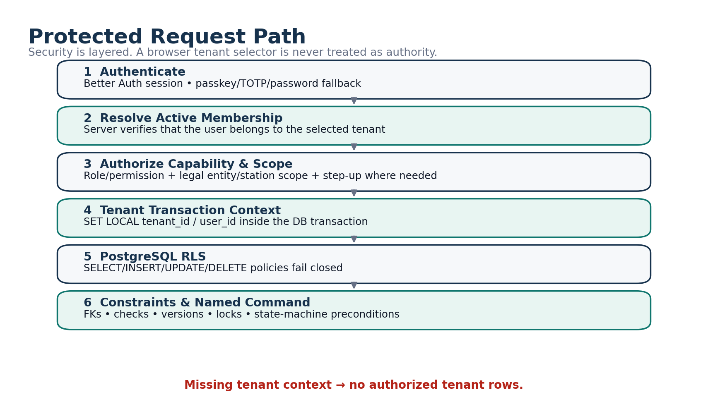

*Figure 6. Protected request path from authentication through authorization, tenant context, RLS and database constraints.*

<table>
<colgroup>
<col style="width: 100%" />
</colgroup>
<thead>
<tr class="header">
<th>WAF / TLS / rate limits 
→ Better Auth session 
→ Active tenant membership validation 
→ Permission + scope authorization 
→ Tenant DB transaction context 
→ PostgreSQL RLS 
→ composite tenant-aware FKs + CHECK/UNIQUE/exclusion constraints 
→ domain ledgers + audit</th>
</tr>
</thead>
<tbody>
</tbody>
</table>

## **12.2 Authentication**

- Better Auth identity/session layer; Shanda owns tenant membership and business authorization.

- Passkey preferred; password + TOTP fallback; no SMS dependency initially.

- Strong authentication required for Owner/Admin/Finance/Supervisor by default.

- High-risk step-up sessions are short-lived; two step-up levels may be used for very sensitive actions.

- Disabling membership revokes sessions, grants and outstanding access while retaining historical identity.

## **12.3 Database Isolation**

- Business tables carry tenant_id; important parent keys are unique as (tenant_id, id); child foreign keys repeat tenant_id so cross-tenant linkage fails at PostgreSQL level.

- Runtime DB role is not schema owner and cannot alter/disable RLS.

- Every normal read and write runs through a transaction-local tenant context; missing context fails closed.

- Background jobs execute under explicit tenant/source context rather than hidden bypass credentials.

- SECURITY DEFINER functions are prohibited by default unless narrowly reviewed.

## **12.4 Support Access**

Support has no permanent unrestricted customer-data role. Access is temporary, scoped, expiring, owner-authorized where practical, read-only by default, visibly bannered in the customer UI and audited under a separate SUPPORT actor rather than impersonating the user.

## **12.5 Sensitive Data & Exports**

- Full bank account details are encrypted/permission-controlled; UI normally uses masked identifiers.

- Logs redact sensitive content; no session replay with sensitive financial forms.

- Export authorization is rechecked at request, worker execution and download.

- Notification previews contain minimal safe information; sensitive amounts/details remain inside the authenticated app.

# **13. Engineering Architecture**

## **13.1 Recommended Stack**

| **Layer**          | **Recommendation**                                                                   |
|--------------------|--------------------------------------------------------------------------------------|
| Web application    | Next.js 16.x, Node 24 LTS, TypeScript strict                                         |
| Hosting            | Separate Shanda Fuel Vercel project; core financial runtime on Node, not Edge        |
| Database           | Neon PostgreSQL with explicit RLS and Drizzle ORM                                    |
| Authentication     | Better Auth                                                                          |
| Validation/forms   | Zod; React Hook Form for complex forms, native/simple server forms where appropriate |
| UI                 | Tailwind + semantic CSS variables + Radix primitives + own design system + Lucide    |
| Decimal arithmetic | decimal.js plus PostgreSQL NUMERIC; never JS floating point for money/stock truth    |
| Documents          | Cloudflare R2 private buckets/prefix policy separation                               |
| Email              | Resend behind adapter                                                                |
| PDF/XLSX           | React PDF for deterministic PDFs; ExcelJS for real workbooks                         |
| Testing            | Vitest, Playwright, axe, real PostgreSQL integration/RLS tests                       |
| CI/CD              | GitHub Actions + Vercel                                                              |

## **13.2 Modular Monolith**

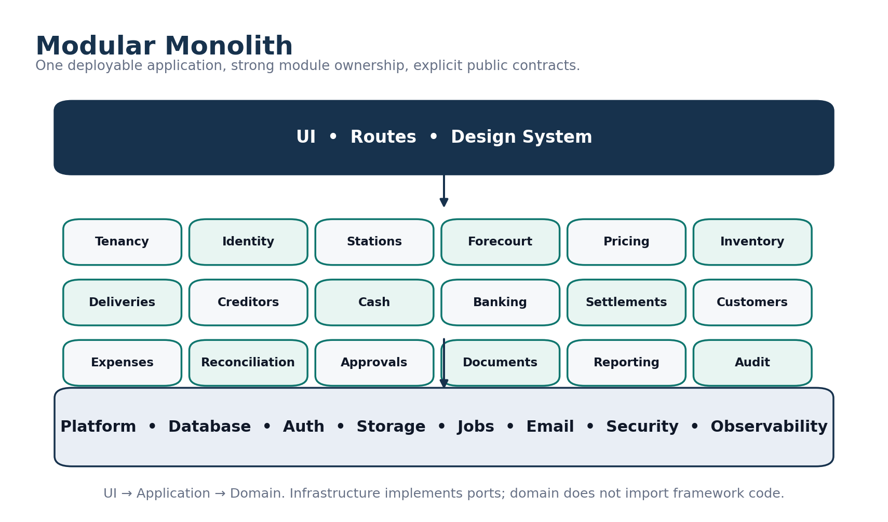

*Figure 7. Modular-monolith ownership model and dependency direction.*

<table>
<colgroup>
<col style="width: 100%" />
</colgroup>
<thead>
<tr class="header">
<th>src/ 
app/ # Next routes/adapters only 
modules/ 
tenancy identity authorization stations configuration 
forecourt pricing tanks inventory deliveries purchasing creditors 
cash banking settlements customers expenses reconciliation 
approvals exceptions documents reporting notifications audit onboarding 
platform/ 
db auth storage email jobs security observability idempotency 
design-system/ 
shared/ # deliberately tiny</th>
</tr>
</thead>
<tbody>
</tbody>
</table>

Each module owns domain/application/infrastructure/ui/schema/tests and exposes a small public API. UI does not call the database directly; cross-module financial integrity uses real typed relationships, not a generic universal transactions table.

## **13.3 Command Pipeline**

<table>
<colgroup>
<col style="width: 100%" />
</colgroup>
<thead>
<tr class="header">
<th>UI / Server Action / Route Handler 
→ authenticate 
→ authorize permission + scope 
→ validate command DTO 
→ check idempotency 
→ BEGIN tenant DB transaction 
→ lock roots deterministically 
→ verify state/version/approval 
→ domain command 
→ ledger/business rows 
→ projections 
→ audit + outbox 
→ COMMIT 
→ authoritative response</th>
</tr>
</thead>
<tbody>
</tbody>
</table>

## **13.4 Numeric & ID Conventions**

| **Type**               | **Database convention**                 |
|------------------------|-----------------------------------------|
| Money                  | NUMERIC(20,4) + currency code           |
| Litres/dips            | NUMERIC(18,3)                           |
| Selling price          | NUMERIC(20,6)                           |
| Weighted unit cost     | NUMERIC(20,8)                           |
| Intermediate valuation | NUMERIC(24,8)                           |
| Ratios                 | NUMERIC(18,8)                           |
| Internal IDs           | UUIDv7                                  |
| Human references       | Atomic document counters; never MAX()+1 |

## **13.5 Database Principles**

- No universal transactions table; separate ledgers preserve semantics.

- No giant JSON settings blob for core business rules; important configuration is relational and effective-dated.

- JSONB is narrow-use metadata, not a substitute for financial relationships.

- No generic soft delete everywhere; domains use explicit lifecycle/archive rules.

- Current balance/state tables are projections and rebuildable.

- Named state-transition commands only; no arbitrary status mutation API.

- Deterministic lock ordering and optimistic version checks handle concurrency safely.

# **14. Offline, Background Work & Integrations**

## **14.1 Offline/PWA Policy**

| **Allowed offline/local**                                                   | **Online required**                                                                              |
|-----------------------------------------------------------------------------|--------------------------------------------------------------------------------------------------|
| Limited meter draft, dip draft, expense draft, notes, selected upload queue | Approval, posting, reversal, price activation, bank changes, supplier payment, privilege changes |
| Tenant/user scoped IndexedDB with purge on logout/offboarding               | Any action that creates authoritative money/stock/permission state                               |

The UI may say “draft saved on this device” but never “submitted/approved/posted” until the server confirms.

## **14.2 Transactional Outbox & Jobs**

Business transactions write outbox events in the same DB transaction. Workers claim leased jobs and perform idempotent effects. The system targets at-least-once execution with exactly-once business effects through idempotency rather than claiming impossible exactly-once execution infrastructure.

- Typical jobs: report generation, email/in-app notification, audit checkpointing, scheduled alerts and safe projection refresh/rebuild.

- Cron/webhook entry points are authenticated; future external webhooks add replay protection.

- Job attempts, errors and durations are persisted for operations/debugging.

## **14.3 ShandaHR Integration Boundary**

ShandaHR and Shanda Fuel remain separate operational systems. Future integration uses explicit APIs/SSO contracts. ShandaHR remains authoritative for employee/payroll information; Fuel consumes only fields needed for access/station context or approved recurring payroll cost integration.

## **14.4 Future Integration Adapters**

- Bank statement import and matching.

- Provider statement/API ingestion.

- DocumentProcessor/OCR suggestions that never silently post transactions.

- Native mobile clients if PWA limitations become measured constraints.

# **15. Onboarding, Forms & Cutover Data**

## **15.1 Development vs Onboarding Boundary**

<table>
<colgroup>
<col style="width: 100%" />
</colgroup>
<thead>
<tr class="header">
<th>
<strong>IMPORTANT</strong>

Bank accounts, payment providers, tank capacities, calibration points, pump serials, supplier/customer lists, station floats and opening balances are tenant onboarding data. Their absence does not stop the software build.
</th>
</tr>
</thead>
<tbody>
</tbody>
</table>

## **15.2 Discovery / Setup Workbook**

The companion “Shanda Fuel Discovery, Setup & Operational Forms Pack” is the working capture mechanism for real TEI setup values and our proposed replacement forms. It includes:

| **Workbook area**                                               | **Purpose**                                                                |
|-----------------------------------------------------------------|----------------------------------------------------------------------------|
| Locations / Pilot / Shifts                                      | Confirm site types, pilot station and station-specific shift clock times   |
| Banks / Payment Channels                                        | Capture bank accounts, POS/EcoCash/provider IDs and settlement behavior    |
| Tanks / Calibration / Pumps-Nozzles                             | Capture physical station configuration and approved calibration sources    |
| Suppliers / Customers                                           | Master data and opening commercial terms/balances                          |
| Approvals / Cash / Variance Alerts                              | Pilot defaults and station/company policy tuning                           |
| Tax & Accounting                                                | Accountant confirmation register; not a software-design blocker            |
| Opening Inventory / Money / Accounts                            | Approved cutover positions                                                 |
| Recent History                                                  | Selective reference import only where useful/clean                         |
| Daily Reconciliation / Delivery / Cash Handover / Expense Forms | Authored operational reference forms that inform the application workflows |

## **15.3 Opening Position Batch**

The new authoritative history starts with one approved opening-position batch per cutover scope and all Shanda Fuel transactions thereafter. Outstanding items at cutover are opening positions even though they may refer to older invoices/transactions.

| **Opening position type** | **Examples**                                                                     |
|---------------------------|----------------------------------------------------------------------------------|
| Inventory                 | Pool/product quantity and value plus physical dip evidence                       |
| Cash                      | Station safe/drawer, collector/transit, management custody                       |
| Bank / provider           | Tracked bank starting amount if used; unsettled POS/EcoCash/provider receivables |
| Supplier                  | Open invoices, supplier credits/prepayments, unbilled exposure as needed         |
| Customer                  | Open receivables, unapplied credits, prepaid value, prepaid litres               |
| Obligations               | Known unpaid operating expenses/recurring obligations                            |

## **15.4 Selective Recent History**

Recent closed history may be imported for comparison or user continuity only when useful and sufficiently clean. It does not become authoritative new-ledger movement unless it represents an outstanding cutover position.

# **16. Testing, Quality & Definition of Done**

## **16.1 Test Layers**

| **Layer**              | **Examples**                                                                                                      |
|------------------------|-------------------------------------------------------------------------------------------------------------------|
| Domain unit tests      | State transition rules, WAC arithmetic, settlement variance, allocation rules, authorization/reservation behavior |
| Property-based tests   | Cash conservation, allocation caps, prepaid non-negative balances, inventory quantity/value conservation          |
| PostgreSQL integration | Transactions, constraints, exclusion ranges, idempotency and projection updates                                   |
| RLS/security           | Tenant isolation for CRUD/search/export/jobs; missing tenant context fail-closed                                  |
| E2E / Playwright       | Critical user journeys from station operations through approval/posting/reporting                                 |
| Accessibility          | Keyboard/focus/labels/status semantics, axe checks, reduced-motion behavior                                       |
| Migration/restore      | Fresh schema, upgrade path, backup restore, tenant-scoped recovery procedure                                      |

## **16.2 Definition of Done for a Vertical Slice**

- Schema migration and rollback/forward strategy considered.

- Tenant isolation and authorization covered by tests.

- Server-side validation and typed command DTO implemented.

- Duplicate/idempotency/concurrency behavior handled.

- Decimal/currency/litre calculations use canonical utilities.

- Audit/outbox behavior included in the same transaction.

- Loading, empty, error, conflict and weak-network states implemented.

- Mobile and desktop responsive behavior reviewed.

- Correction/reversal behavior specified before posting is enabled.

- Observability and user-safe error codes included.

- Module docs and acceptance scenarios updated.

## **16.3 Performance Targets**

| **Target**       | **Planning goal**                                                                                              |
|------------------|----------------------------------------------------------------------------------------------------------------|
| Ordinary command | Usually \< 1 second under reasonable regional mobile conditions, excluding network latency outside our control |
| Useful page      | ~2 seconds or better for common screens under reasonable conditions; progressive loading allowed               |
| Large reports    | Background job, never block ordinary request execution                                                         |
| Low bandwidth    | Compress images, avoid unnecessary data payloads, preserve drafts and provide truthful retry                   |

# **17. Delivery Plan & Build Sequence**

## **17.1 Development Strategy**

Build vertical slices that create real operational value and exercise the full security/data architecture early. Avoid building every table before any complete workflow works.

| **Phase**                               | **Approx. planning duration** | **Primary output**                                                                   |
|-----------------------------------------|-------------------------------|--------------------------------------------------------------------------------------|
| 0\. Blueprint / repo / ERD / wireframes | ~1 week                       | This specification, schema plan, design system skeleton, environments                |
| 1\. Foundation                          | ~2 weeks                      | Tenancy, auth, roles, stations/config, documents, audit, RLS, CI                     |
| 2\. Core station vertical slice         | ~3 weeks                      | Business day → shift → meters → declarations → reconciliation → approval/post/report |
| 3\. Inventory / delivery / costing      | ~3 weeks                      | Tanks/dips, delivery, inventory movements, WAC/revaluation                           |
| 4\. Money                               | ~3 weeks                      | Cash custody, collection/deposit, bank tracking, POS/EcoCash settlement              |
| 5\. Suppliers / customers / expenses    | ~3 weeks                      | Creditors, customer accounts/prepaid, payments, expenses/fixed costs                 |
| 6\. Profit / reporting                  | ~2 weeks                      | Profitability, operational position, curated PDF/XLSX reports                        |
| 7\. Hardening                           | ~2–3 weeks                    | Security, performance, accessibility, restore drills, failure/reversal scenarios     |
| 8\. Pilot                               | ~1–2 weeks                    | One real station shadow operation, discrepancy resolution and sign-off               |

Planning estimate: roughly 18–22 weeks / 700–950 development hours for a strong full-time single developer; part-time/junior delivery will take longer. These are planning ranges, not contractual promises.

## **17.2 First Six-Week Objective**

<table>
<colgroup>
<col style="width: 100%" />
</colgroup>
<thead>
<tr class="header">
<th>
<strong>MILESTONE</strong>

One real station can complete a full shift, capture meters/declarations, reconcile the day, submit/approve/post it, and produce traceable operational reporting with tenant isolation and audit intact.
</th>
</tr>
</thead>
<tbody>
</tbody>
</table>

## **17.3 Build Order by Dependency**

1.  Foundation tenancy/auth/RLS/roles/stations/configuration/documents/audit/idempotency/outbox.

2.  Station business day, shifts, meter installation/boundaries/segments, pricing and declarations.

3.  Reconciliation revision/approval/sale recognition and basic daily report.

4.  Cash custody, handovers, collections, deposits and bank confirmation.

5.  Tanks/dips, deliveries, inventory movement/WAC/revaluation.

6.  Supplier invoices/payments/credit exposure.

7.  Customer authorization/credit/prepaid/payments.

8.  Expenses/recurring costs and profitability.

9.  Full report catalogue, exports, alerts, hardening and pilot readiness.

# **18. Pilot, Rollout & Production Readiness**

## **18.1 Pilot Preparation**

- Select one representative TEI operating location; exact site can be chosen while development is underway.

- Populate real station master data: users, products, pumps/nozzles/meters, tanks/calibration, payment channels, prices, bank/cash policy.

- Prepare and approve opening positions.

- Train role-specific users in staging using realistic synthetic/pilot data.

- Run Shanda Fuel alongside the existing process for approximately 7–14 operating days.

## **18.2 Daily Pilot Discrepancy Classification**

| **Class**                    | **Meaning**                                                            |
|------------------------------|------------------------------------------------------------------------|
| Software defect              | Shanda calculated/behaved incorrectly                                  |
| Old-process problem          | Paper/Excel process itself produced inconsistent or unsupported result |
| Source-data issue            | Wrong/late/missing master or operational data                          |
| Formula/policy clarification | Business rule needs explicit client/accountant decision                |
| Training/usability           | System is correct but user interaction is confusing/slow               |

## **18.3 Pilot Exit Gates**

- Approximately seven clean operating days with no critical unresolved issue.

- Meter/reconciliation, cash, delivery/stock and profitability formulas signed off by appropriate business owners.

- Users can perform their normal role without developer intervention.

- Backup/restore drill completed; key security controls verified.

- Opening positions and major customer/supplier balances reconcile.

## **18.4 Rollout Sequence**

<table>
<colgroup>
<col style="width: 100%" />
</colgroup>
<thead>
<tr class="header">
<th>Staging / UAT 
→ 1 TEI pilot location 
→ 2–3 TEI locations 
→ all TEI locations 
→ stabilization 
→ second independent tenant 
→ broader commercial rollout</th>
</tr>
</thead>
<tbody>
</tbody>
</table>

Do not treat a single-company deployment as proof of commercial SaaS readiness. Customer \#2 should be onboarded without manual database edits, and an independent penetration test should precede broad commercial rollout.

# **19. Hosting, Operations, Backup & Recovery**

## **19.1 Environment Separation**

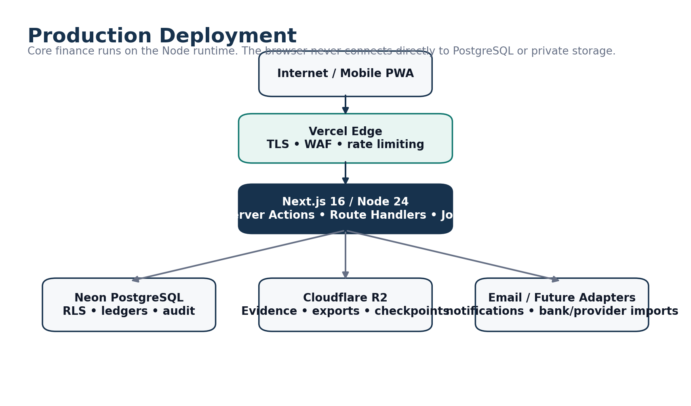

*Figure 8. Production deployment and infrastructure boundary.*

| **Environment** | **Rule**                                                                                            |
|-----------------|-----------------------------------------------------------------------------------------------------|
| Local           | Developer data only; no production credentials                                                      |
| Staging         | Separate Neon/R2/auth secrets with synthetic/anonymized data                                        |
| Production      | Separate production Vercel/Neon/R2/secrets/keys; developer DB access by controlled break-glass only |

## **19.2 Backup & Recovery**

- Neon point-in-time recovery plus independent logical backups stored separately from normal runtime blast radius.

- Private documents, report artifacts, audit checkpoints and backups use appropriate distinct storage/lifecycle policy boundaries.

- Restore drills before launch/major DB changes and at least quarterly thereafter.

- Planning targets: RPO \<= 15 minutes and RTO \<= 4 hours for architecture/testing purposes; not presented as contractual SLA until operations are proven.

- Tenant-scoped logical corruption is repaired through isolated restore/extract/repair rather than rolling back all other tenants.

## **19.3 Observability & Incidents**

- Structured logs with correlation/request IDs and sensitive-data redaction.

- Health checks include application/database, jobs, storage, audit checkpointing and backup status.

- P0–P3 incident classification with security, restore and data-repair runbooks.

- No false promise of 24/7 human support unless the commercial support model actually funds it.

## **19.4 Early Operating Cost**

For planning, early production infrastructure should remain in the tens of USD per month rather than hundreds if usage is modest. Keep a rough planning reserve of USD 60–100/month for the core stack, but recheck current vendor pricing at launch rather than treating this as a quote.

# **20. Remaining Confirmation Register**

These items do not stop normal development. They become onboarding, pilot or accountant/legal gates at the appropriate stage.

| **Item**                                                        | **When needed**                                            | **Default / action if not yet supplied**                                |
|-----------------------------------------------------------------|------------------------------------------------------------|-------------------------------------------------------------------------|
| Final active TEI location/station classification and pilot site | Before pilot setup                                         | Use client-provided 11-location seed; do not block code                 |
| Actual shift clock times per station                            | Before station activation                                  | Use configurable 8-hour starter templates                               |
| Banks and POS/EcoCash providers/merchant IDs                    | Before money workflow go-live                              | Provider/bank-neutral structures already built                          |
| Tank capacities, calibration charts, pumps/nozzles/meters       | Before station operations go-live                          | Capture via setup workbook/onboarding                                   |
| Supplier/customer masters and current terms                     | Before commercial module pilot                             | Capture via setup workbook/import                                       |
| Cash floats / reorder levels / station-specific thresholds      | Before station activation or tune during pilot             | Use recommended provisional defaults where safe                         |
| Opening balances                                                | Immediately before cutover                                 | Finance prepares; authorized management approves opening-position batch |
| Tax/VAT/statutory invoice treatment                             | Before tax-specific automation or formal statutory outputs | Remain tax-ready; do not invent treatment                               |
| Retention periods                                               | Before automated deletion/lifecycle policies               | Retain conservatively until accountant/legal confirmation               |
| Exact ShandaHR integration fields                               | Before integration phase                                   | Keep explicit API boundary and manual recurring cost fallback           |

## **20.1 What Is Not a Client Question Anymore**

- Database/hosting architecture, ORM, framework and module boundaries.

- How audit immutability works.

- How tenant isolation/RLS works.

- Whether cash collected equals banked (it does not).

- Whether supplier invoice rewrites delivery quantity (it does not).

- How corrections to posted facts work (reversal/compensation/adjustment).

- How customer credit/prepaid fuel reconciles to meters without duplicate litres.

- How weighted-average inventory cost is preserved across later purchases.

# **21. Implementation Readiness Statement**

<table>
<colgroup>
<col style="width: 100%" />
</colgroup>
<thead>
<tr class="header">
<th>
<strong>READY FOR BUILD</strong>

The logical product architecture is sufficiently specified for implementation to begin without recurring client interruption. Remaining unknowns are predominantly tenant setup/onboarding values and legal/accounting confirmations, not software architecture decisions.
</th>
</tr>
</thead>
<tbody>
</tbody>
</table>

## **21.1 Frozen Logical Layers**

| **Layer**                                 | **Status**                               |
|-------------------------------------------|------------------------------------------|
| Requirements coverage                     | Complete for the supplied V1 brief       |
| Operating/domain model                    | Locked                                   |
| ERD / aggregate boundaries / ledgers      | Locked at logical level                  |
| State machines / named commands           | Locked                                   |
| Roles / permissions / approval philosophy | Locked; business thresholds configurable |
| UX architecture / core screen families    | Locked                                   |
| Security / tenant isolation / audit       | Locked                                   |
| Engineering architecture / stack          | Locked for implementation planning       |
| Onboarding forms / opening-position model | Defined                                  |
| Pilot / rollout plan                      | Defined                                  |

## **21.2 Implementation Guardrails**

- A developer may change a physical index name, component implementation or internal code organization detail when reasonable, but may not silently reinterpret the business model.

- Any proposed change that weakens tenant isolation, immutable posting, cash/fuel conservation, approval versioning or source-of-truth boundaries requires explicit architecture review.

- When a real-world onboarding fact is missing, add/configure the data later; do not hard-code guesses into the domain model.

## **21.3 Immediate Next Engineering Artifact**

After this blueprint, perform the Developer Readiness Review and convert the locked design into exact repository/module conventions, permission-code catalogue, route map, command/query contracts, Drizzle schema/migration sequence, RLS test matrix, seed data, environment-variable register, CI gates and an implementation backlog/ticket dependency graph.

# **Appendix A. Core Aggregate Roots**

| **Domain**         | **Aggregate roots / major entities**                                                                       |
|--------------------|------------------------------------------------------------------------------------------------------------|
| Tenancy & access   | Tenant, Legal Entity, Tenant Membership, Role Assignment                                                   |
| Station operations | Station, Station Business Day, Shift, Meter Installation, Meter Segment, Selling Price Change              |
| Inventory          | Inventory Pool, Tank, Delivery, Inventory Adjustment, Inventory Transfer, Cost Adjustment/Revaluation      |
| Money              | Cash Handover, Cash Collection, Bank Deposit, Bank Account, Payment Channel, Provider Batch/Settlement     |
| Suppliers          | Supplier, Supplier Invoice, Supplier Payment, Supplier Credit Note                                         |
| Customers          | Customer, Customer Account, Fuel Authorization/Transaction, Customer Payment, Customer Invoice/Credit Note |
| Expenses           | Expense, Recurring Cost Template/Period                                                                    |
| Cross-cutting      | Approval Request, Document, Business Exception, Report Run, Opening Position Batch                         |

# **Appendix B. Core Named Commands**

| **Domain**           | **Representative commands**                                                                                                           |
|----------------------|---------------------------------------------------------------------------------------------------------------------------------------|
| Business day / shift | OpenBusinessDay, StartShift, CloseMeters, CompleteShift, MarkNotOperated, ExceptionalClose                                            |
| Meter / price        | ConfirmBoundary, SealSegment, RequestPriceChange, ActivatePriceChange, ReplaceMeter                                                   |
| Delivery / inventory | RecordArrival, BeginOffloading, ConfirmReceipt, PostDelivery, SubmitAdjustment, PostAdjustment, DispatchTransfer, ReceiveTransfer     |
| Reconciliation       | CalculateReconciliation, SubmitReconciliation, ReturnReconciliation, ApproveAndPostReconciliation, LockReconciliation                 |
| Cash / bank          | CountCash, PrepareHandover, SenderConfirmHandover, ReceiverConfirmHandover, ResolveHandoverDispute, RecordDeposit, ConfirmBankReceipt |
| Provider             | RecordProviderBatch, MatchProviderBatch, RecordProviderSettlement, ResolveSettlementDifference                                        |
| Supplier             | SubmitSupplierInvoice, PostSupplierInvoice, SubmitSupplierPayment, PostSupplierPayment, ReverseSupplierPayment                        |
| Customer             | AuthorizeCustomerFuel, CompleteCustomerFuel, RecordCustomerPayment, PostCustomerPayment, GenerateCustomerInvoice                      |
| Expense              | SubmitExpense, ApproveExpense, PostExpense, GenerateRecurringCostPeriod, RecognizeRecurringCost                                       |
| Cross-cutting        | CreateApprovalRequest, ApproveStep, ReturnForCorrection, ExecuteReversal, VerifyDocument, GenerateReport, PostOpeningPositionBatch    |

# **Appendix C. Core Route / Screen Families**

| **Area**        | **Representative screens/routes**                                                                                    |
|-----------------|----------------------------------------------------------------------------------------------------------------------|
| Home / actions  | /app/home, /app/actions                                                                                              |
| Operations      | /operations/today, business-days, shifts, deliveries, dips                                                           |
| Money           | /money/cash, collections, deposits, settlements, bank                                                                |
| Inventory       | /inventory/position, tanks, movements, transfers                                                                     |
| Suppliers       | /suppliers, invoices, payments                                                                                       |
| Customers       | /customers, accounts, payments                                                                                       |
| Expenses        | /expenses                                                                                                            |
| Reports / audit | /reports, /audit                                                                                                     |
| Settings        | organisation, stations, shifts, products, pumps/nozzles, tanks, prices, banks, payment channels, users/roles, alerts |

# **Appendix D. Minimum Acceptance Scenarios**

| **Scenario**                | **Pass condition**                                                                                                 |
|-----------------------------|--------------------------------------------------------------------------------------------------------------------|
| Normal day                  | Shift meters → declarations → reconciliation → approval/post → stock/revenue/profit/cash classifications reconcile |
| Attendant handover          | One shared boundary closes first responsibility and opens next with no duplicated/missing litres                   |
| Mid-shift price change      | Old price remains until boundaries complete; segment values use correct prices                                     |
| Delivery shortage           | Delivery-note quantity differs from accepted quantity; stock uses accepted litres, supplier claim remains separate |
| Late transport cost         | No original movement rewritten; remaining inventory and historical COGS revaluation split correctly                |
| Cash dispute                | Sender/receiver disagreement represented once across custody + dispute                                             |
| Partial provider settlement | Outstanding provider balance and expected/actual settlement variance remain correct                                |
| Supplier payment reversal   | Allocations reverse atomically and invoices reopen                                                                 |
| Customer concurrent credit  | Second authorization cannot exceed remaining available credit after first reservation                              |
| Prepaid litre draw          | Only matching product balance is reduced; no silent product conversion                                             |
| Tenant isolation            | Tenant A cannot read/write/link/export Tenant B data through any application or job path                           |
| Report as-of                | Later posted correction changes later as-of report without altering old artifact/checksum                          |
| Offline draft               | Draft survives interruption; authoritative state stays unchanged until server submission                           |
| Opening cutover             | Approved opening batch posts atomically across configured domains and becomes starting authoritative position      |

# **Appendix E. Companion Artifacts**

This visual edition embeds the architecture/process diagrams and primary mobile/desktop wireframes directly in the DOCX so the blueprint can be reviewed without a separate diagram pack.

| **Artifact**                                               | **Purpose**                                                                                                      |
|------------------------------------------------------------|------------------------------------------------------------------------------------------------------------------|
| Shanda Fuel Discovery, Setup & Operational Forms Pack.xlsx | Capture real station master/setup data, opening positions, provisional policies and reference operational forms. |
| Master ERD / migration dependency map                      | Logical database ownership, cardinalities, RLS/security classes and migration ordering.                          |
| Master State-Machine Pack                                  | Legal record transitions, commands, authority, conditions, effects and recovery routes.                          |
| Screen Architecture & Wireframe Pack                       | Role-specific information architecture and critical workflow layouts.                                            |
| Master Architecture Diagram Pack                           | System/deployment/security/data-flow/recovery architecture.                                                      |
| Requirements Traceability Matrix                           | Requirement → design → module → workflow/data source → acceptance coverage.                                      |

# Appendix F. V1 Mid-Fidelity Wireframe Pack

This appendix embeds the complete screen-flow boards used for V1 implementation. It replaces the earlier conceptual mockup gallery as the authoritative UX reference. For easier UX review, the same material is also delivered as a standalone Wireframe Pack v1.2.

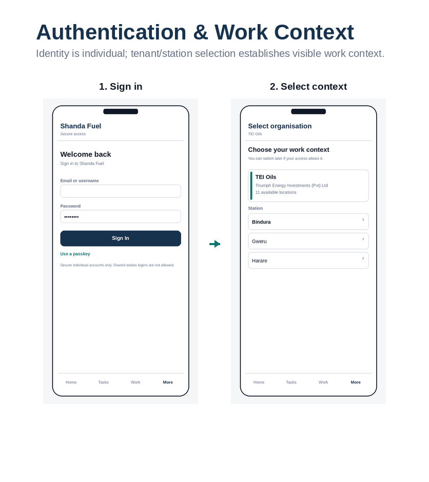

Wireframe board F.1: Authentication & work context. Role: Identity & tenancy.

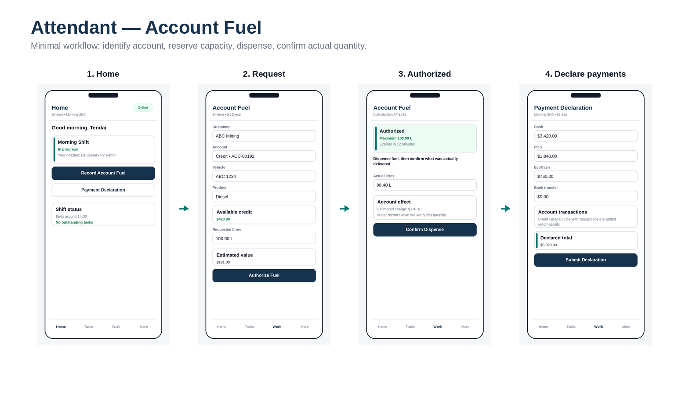

Wireframe board F.2: Attendant — account fuel. Role: Attendant.

Wireframe board F.3: Attendant — correction loop. Role: Attendant / Supervisor.

Wireframe board F.4: Supervisor — start shift. Role: Supervisor.

Wireframe board F.5: Supervisor — close & reconcile. Role: Supervisor.

Wireframe board F.6: Reconciliation — submit & approval wait. Role: Supervisor / Management.

Wireframe board F.7: Delivery — guided physical receipt. Role: Supervisor / Delivery Receiver.

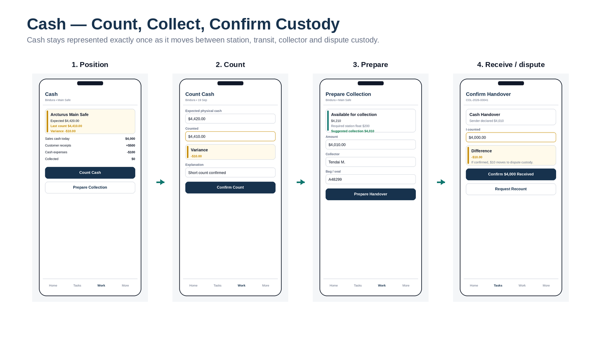

Wireframe board F.8: Cash — count, collect, confirm custody. Role: Supervisor / Collector.

Wireframe board F.9: Finance — queue-based work. Role: Finance.

Wireframe board F.10: Banking & electronic settlement. Role: Finance.

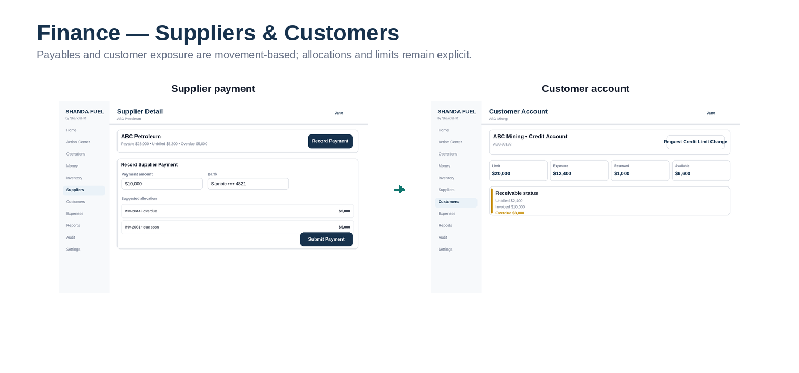

Wireframe board F.11: Suppliers & customers. Role: Finance.

Wireframe board F.12: Owner — oversight & approval. Role: Owner / Admin.

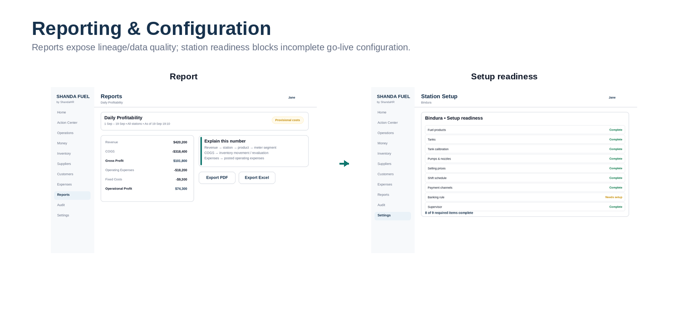

Wireframe board F.13: Reporting & station readiness. Role: Owner / Finance / Admin.

Wireframe board F.14: Security & controlled configuration. Role: Owner / Admin.

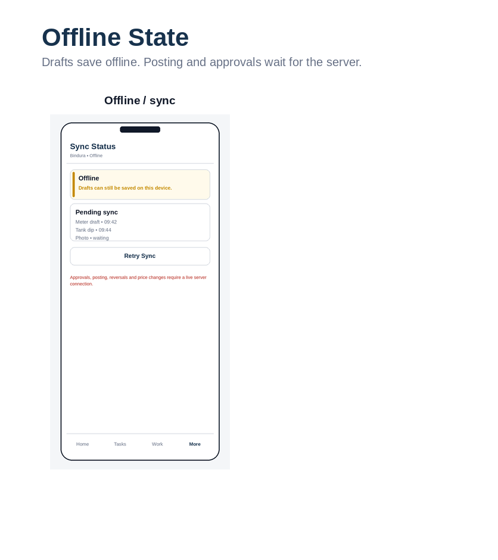

Wireframe board F.15: Weak-connection state. Role: All mobile roles.

## F.16 Screen-to-Command Mapping

| **ID** | **Screen**                     | **Role**          | **Device**    | **Primary action**         | **Command / state action**                 |
|--------|--------------------------------|-------------------|---------------|----------------------------|--------------------------------------------|
| WF-01  | Sign in                        | All users         | Mobile/Web    | Sign in                    | Authenticate                               |
| WF-02  | Select organisation / station  | Multi-scope users | Mobile/Web    | Select context             | SelectTenantContext                        |
| WF-03  | Attendant Home                 | Attendant         | Mobile        | Start role task            | —                                          |
| WF-04  | Account Fuel Request           | Attendant         | Mobile        | Authorize Fuel             | RequestCustomerFuelAuthorization           |
| WF-05  | Account Fuel Authorized        | Attendant         | Mobile        | Confirm Dispense           | CompleteCustomerFuelTransaction            |
| WF-06  | Payment Declaration            | Attendant         | Mobile        | Submit Declaration         | SubmitPaymentDeclaration                   |
| WF-07  | Returned Declaration           | Attendant         | Mobile        | Correct Declaration        | ResubmitPaymentDeclaration                 |
| WF-08  | Supervisor Today               | Supervisor        | Mobile        | Continue Shift             | —                                          |
| WF-09  | Start Shift — Team             | Supervisor        | Mobile        | Continue                   | AssignShiftTeam                            |
| WF-10  | Start Shift — Opening Readings | Supervisor        | Mobile        | Confirm readings           | ConfirmMeterBoundary                       |
| WF-11  | Shift Workflow                 | Supervisor        | Mobile        | Open task                  | —                                          |
| WF-12  | Nozzle Handover                | Supervisor        | Mobile        | Confirm Handover           | HandoverNozzle                             |
| WF-13  | Close Shift                    | Supervisor        | Mobile        | Meter Close Shift          | CloseMeters                                |
| WF-14  | Reconciliation Summary         | Supervisor        | Mobile        | Review exceptions          | CalculateReconciliation                    |
| WF-15  | Reconciliation Exceptions      | Supervisor        | Mobile        | Save explanation           | ResolveReconciliationException             |
| WF-16  | Submit Reconciliation          | Supervisor        | Mobile        | Submit Reconciliation      | SubmitReconciliation                       |
| WF-17  | Reconciliation Waiting         | Supervisor        | Mobile        | View revision              | —                                          |
| WF-18  | Delivery Verification          | Supervisor        | Mobile/Tablet | Continue                   | StartDeliveryVerification                  |
| WF-19  | Before Offload                 | Supervisor        | Mobile/Tablet | Capture Boundary & Begin   | BeginOffloading                            |
| WF-20  | Delivery Interrupted           | Supervisor        | Mobile/Tablet | Resume / Finish Partial    | ResumeOffloading / FinishPartialReceipt    |
| WF-21  | Delivery Review                | Supervisor        | Mobile/Tablet | Confirm Receipt            | ConfirmDelivery                            |
| WF-22  | Cash Position                  | Supervisor        | Mobile        | Count / Prepare Collection | —                                          |
| WF-23  | Cash Count                     | Supervisor        | Mobile        | Confirm Count              | ConfirmCashCount                           |
| WF-24  | Prepare Collection             | Supervisor        | Mobile        | Prepare Handover           | PrepareCashCollection                      |
| WF-25  | Confirm Handover               | Collector         | Mobile        | Confirm received amount    | ConfirmCashHandover                        |
| WF-26  | Offline / Sync                 | Mobile roles      | Mobile        | Retry Sync                 | SyncDraft                                  |
| WF-27  | Finance Home                   | Finance           | Desktop       | Open Action Center         | —                                          |
| WF-28  | Action Center                  | Finance           | Desktop       | Resolve / Match            | ResolveException                           |
| WF-29  | Deposit Confirmation           | Finance           | Desktop       | Confirm Bank Receipt       | ConfirmBankReceipt                         |
| WF-30  | Provider Settlement            | Finance           | Desktop       | Review Matching            | MatchProviderSettlement                    |
| WF-31  | Supplier Payment               | Finance           | Desktop       | Submit Payment             | SubmitSupplierPayment                      |
| WF-32  | Customer Account               | Finance           | Desktop       | Request limit change       | RequestCustomerLimitChange                 |
| WF-33  | Owner Dashboard                | Owner             | Desktop       | Review Action Center       | —                                          |
| WF-34  | Approval Review                | Owner             | Desktop       | Approve / Return           | ApproveSupplierPayment / ReturnApproval    |
| WF-35  | Report View                    | Owner / Finance   | Desktop       | Export / Explain           | GenerateReport / GenerateExport            |
| WF-36  | Setup Readiness                | Admin             | Desktop       | Configure missing item     | ValidateStationReadiness                   |
| WF-37  | User Access                    | Owner / Admin     | Desktop       | Edit Access / Disable      | ChangeMembershipAccess / DisableMembership |
| WF-38  | Price Change                   | Pricing authority | Desktop       | Submit Price Change        | SubmitPriceChange                          |
