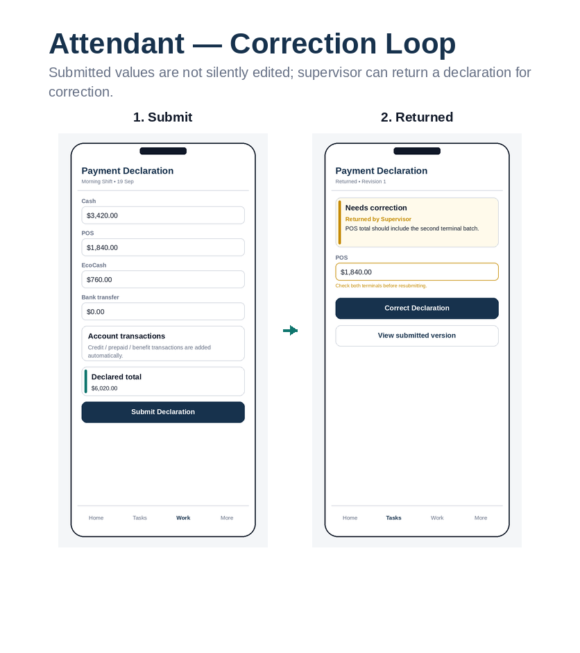
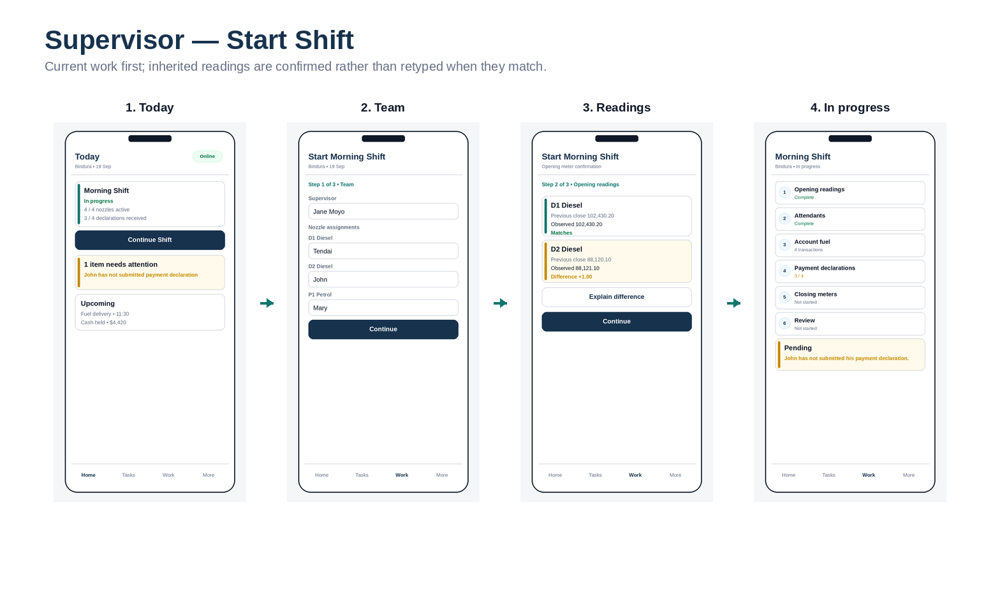
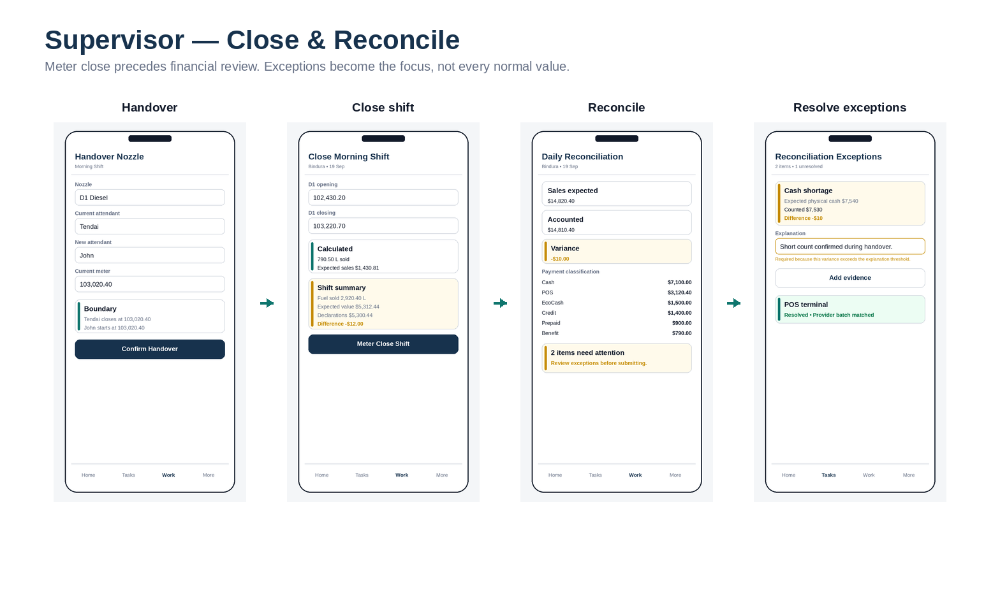
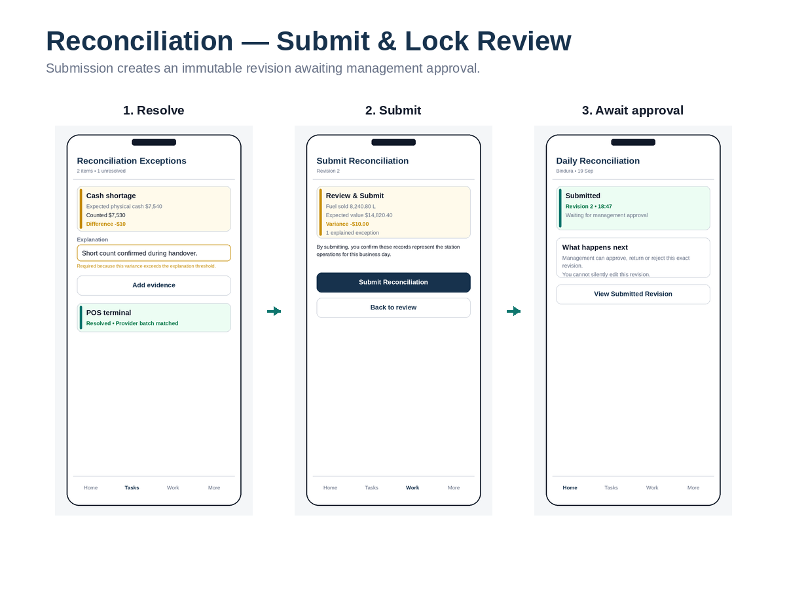
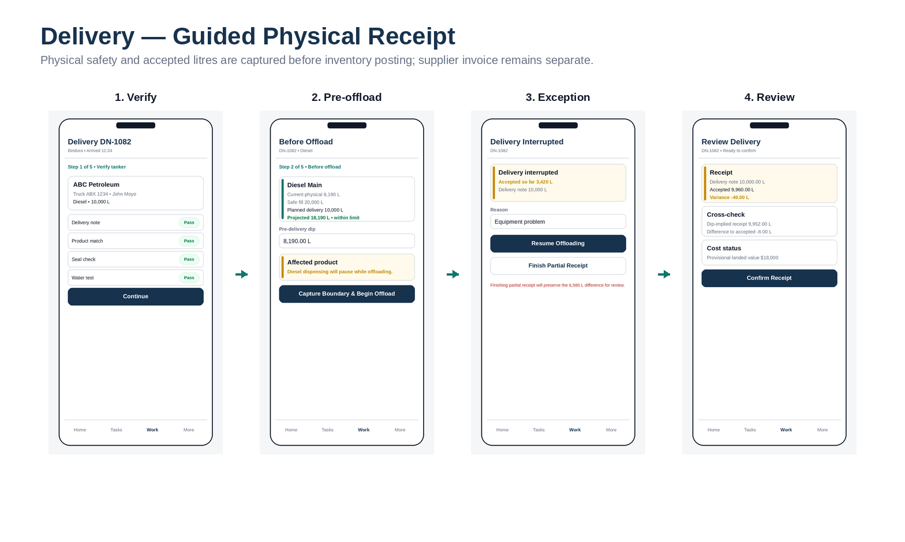
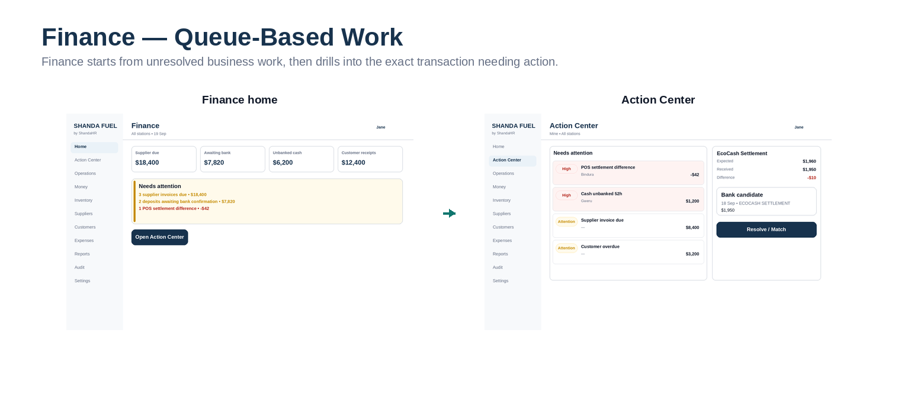
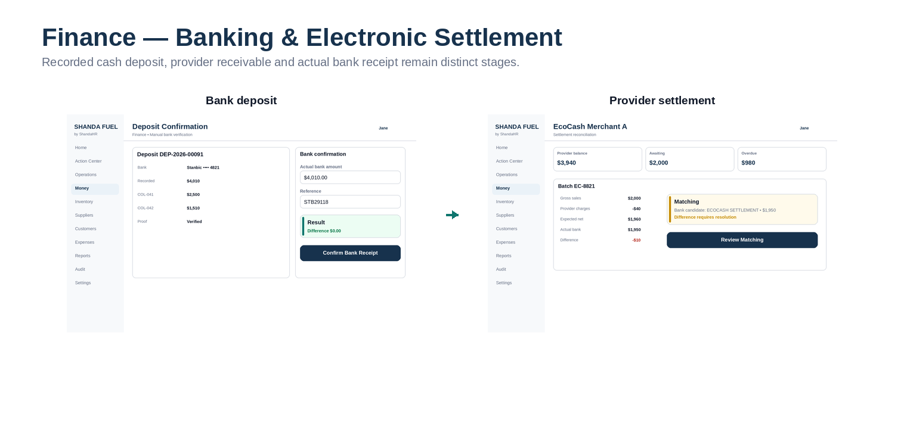
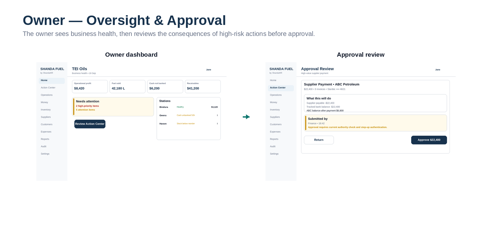
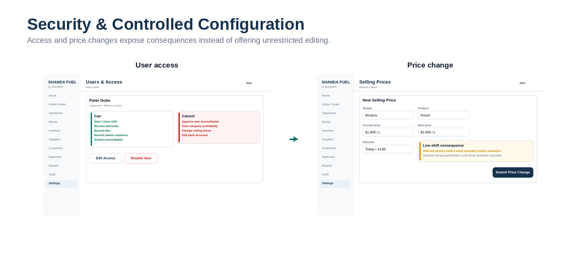

**Shanda Fuel**

**V1 Mid-Fidelity Wireframe Pack**

Version 1.2 • Product/UX implementation reference

Purpose: define actual screen hierarchy, navigation, fields, primary actions, warnings and role behavior before implementation. These are wireframes, not pixel-perfect final visual design.

Locked UX principle: Simple by default. Powerful when needed. Explicit when risky.

# 1. Wireframe Rules

- Mobile operational workflows are first-class; desktop is not simply shrunk onto a phone.

- Every screen exposes the active organisation/station/date/shift context where relevant.

- One dominant primary action per screen where practical; secondary actions are visually subordinate.

- Normal values are quiet; exceptions and consequences receive visual priority.

- Meter-derived litres are canonical for ordinary forecourt sales.

- Posted/approved financial records do not expose normal Edit/Delete actions.

- Authoritative actions only show success after server confirmation.

- Offline mode supports drafts and capture, not approvals/posting/reversals/price activation.

Fidelity: mid-fidelity. Layout, wording, interaction hierarchy and domain meaning are implementation requirements; exact spacing, font metrics and final brand polish may evolve within the design system.

# 2. User-Flow Boards

Each board shows the main screen sequence a user experiences. The green arrows indicate the expected forward path; exception/return paths are shown inside the relevant screens.

Wireframe board 1: Authentication & work context. Role: Identity & tenancy.

Wireframe board 2: Attendant — account fuel. Role: Attendant.

Wireframe board 3: Attendant — correction loop. Role: Attendant / Supervisor.

Wireframe board 4: Supervisor — start shift. Role: Supervisor.

Wireframe board 5: Supervisor — close & reconcile. Role: Supervisor.

Wireframe board 6: Reconciliation — submit & approval wait. Role: Supervisor / Management.

Wireframe board 7: Delivery — guided physical receipt. Role: Supervisor / Delivery Receiver.

Wireframe board 8: Cash — count, collect, confirm custody. Role: Supervisor / Collector.

Wireframe board 9: Finance — queue-based work. Role: Finance.

Wireframe board 10: Banking & electronic settlement. Role: Finance.

Wireframe board 11: Suppliers & customers. Role: Finance.

Wireframe board 12: Owner — oversight & approval. Role: Owner / Admin.

Wireframe board 13: Reporting & station readiness. Role: Owner / Finance / Admin.

Wireframe board 14: Security & controlled configuration. Role: Owner / Admin.

Wireframe board 15: Weak-connection state. Role: All mobile roles.

# 3. Screen Inventory & Command Mapping

This mapping prevents UI work from inventing new business behavior. A screen may gather draft input, but authoritative state changes must call the named application/domain command shown here.

| **ID** | **Screen**                     | **Role**          | **Device**    | **Route family**                            | **Primary action**         | **Command / state action**                 | **Connectivity**              |
|--------|--------------------------------|-------------------|---------------|---------------------------------------------|----------------------------|--------------------------------------------|-------------------------------|
| WF-01  | Sign in                        | All users         | Mobile/Web    | /login                                      | Sign in                    | Authenticate                               | Online                        |
| WF-02  | Select organisation / station  | Multi-scope users | Mobile/Web    | /select-organisation                        | Select context             | SelectTenantContext                        | Online                        |
| WF-03  | Attendant Home                 | Attendant         | Mobile        | /app/home                                   | Start role task            | —                                          | Cached view okay              |
| WF-04  | Account Fuel Request           | Attendant         | Mobile        | /app/work/account-fuel/new                  | Authorize Fuel             | RequestCustomerFuelAuthorization           | Online                        |
| WF-05  | Account Fuel Authorized        | Attendant         | Mobile        | /app/work/account-fuel/{id}                 | Confirm Dispense           | CompleteCustomerFuelTransaction            | Online                        |
| WF-06  | Payment Declaration            | Attendant         | Mobile        | /app/work/payment-declaration               | Submit Declaration         | SubmitPaymentDeclaration                   | Draft offline; submit online  |
| WF-07  | Returned Declaration           | Attendant         | Mobile        | /app/tasks/{id}                             | Correct Declaration        | ResubmitPaymentDeclaration                 | Online submit                 |
| WF-08  | Supervisor Today               | Supervisor        | Mobile        | /app/operations/today                       | Continue Shift             | —                                          | Cached view okay              |
| WF-09  | Start Shift — Team             | Supervisor        | Mobile        | /app/operations/shifts/{id}/start           | Continue                   | AssignShiftTeam                            | Online                        |
| WF-10  | Start Shift — Opening Readings | Supervisor        | Mobile        | /app/operations/shifts/{id}/start           | Confirm readings           | ConfirmMeterBoundary                       | Online                        |
| WF-11  | Shift Workflow                 | Supervisor        | Mobile        | /app/operations/shifts/{id}                 | Open task                  | —                                          | Mixed                         |
| WF-12  | Nozzle Handover                | Supervisor        | Mobile        | /app/operations/nozzles/{id}/handover       | Confirm Handover           | HandoverNozzle                             | Online                        |
| WF-13  | Close Shift                    | Supervisor        | Mobile        | /app/operations/shifts/{id}/close           | Meter Close Shift          | CloseMeters                                | Online                        |
| WF-14  | Reconciliation Summary         | Supervisor        | Mobile        | /app/operations/reconciliations/{id}        | Review exceptions          | CalculateReconciliation                    | Online calculation            |
| WF-15  | Reconciliation Exceptions      | Supervisor        | Mobile        | /app/tasks/{id}                             | Save explanation           | ResolveReconciliationException             | Online final                  |
| WF-16  | Submit Reconciliation          | Supervisor        | Mobile        | /app/operations/reconciliations/{id}/submit | Submit Reconciliation      | SubmitReconciliation                       | Online                        |
| WF-17  | Reconciliation Waiting         | Supervisor        | Mobile        | /app/operations/reconciliations/{id}        | View revision              | —                                          | Read online/cached            |
| WF-18  | Delivery Verification          | Supervisor        | Mobile/Tablet | /app/operations/deliveries/{id}             | Continue                   | StartDeliveryVerification                  | Online                        |
| WF-19  | Before Offload                 | Supervisor        | Mobile/Tablet | /app/operations/deliveries/{id}             | Capture Boundary & Begin   | BeginOffloading                            | Online                        |
| WF-20  | Delivery Interrupted           | Supervisor        | Mobile/Tablet | /app/operations/deliveries/{id}             | Resume / Finish Partial    | ResumeOffloading / FinishPartialReceipt    | Online                        |
| WF-21  | Delivery Review                | Supervisor        | Mobile/Tablet | /app/operations/deliveries/{id}             | Confirm Receipt            | ConfirmDelivery                            | Online                        |
| WF-22  | Cash Position                  | Supervisor        | Mobile        | /app/money/cash                             | Count / Prepare Collection | —                                          | Cached view okay              |
| WF-23  | Cash Count                     | Supervisor        | Mobile        | /app/money/cash/count                       | Confirm Count              | ConfirmCashCount                           | Draft offline; confirm online |
| WF-24  | Prepare Collection             | Supervisor        | Mobile        | /app/money/collections/new                  | Prepare Handover           | PrepareCashCollection                      | Online                        |
| WF-25  | Confirm Handover               | Collector         | Mobile        | /app/tasks/{id}                             | Confirm received amount    | ConfirmCashHandover                        | Online                        |
| WF-26  | Offline / Sync                 | Mobile roles      | Mobile        | /app/sync                                   | Retry Sync                 | SyncDraft                                  | Connection dependent          |
| WF-27  | Finance Home                   | Finance           | Desktop       | /app/home                                   | Open Action Center         | —                                          | Online                        |
| WF-28  | Action Center                  | Finance           | Desktop       | /app/actions                                | Resolve / Match            | ResolveException                           | Online                        |
| WF-29  | Deposit Confirmation           | Finance           | Desktop       | /app/money/deposits/{id}                    | Confirm Bank Receipt       | ConfirmBankReceipt                         | Online                        |
| WF-30  | Provider Settlement            | Finance           | Desktop       | /app/money/settlements/{id}                 | Review Matching            | MatchProviderSettlement                    | Online                        |
| WF-31  | Supplier Payment               | Finance           | Desktop       | /app/suppliers/{id}                         | Submit Payment             | SubmitSupplierPayment                      | Online                        |
| WF-32  | Customer Account               | Finance           | Desktop       | /app/customers/accounts/{id}                | Request limit change       | RequestCustomerLimitChange                 | Online                        |
| WF-33  | Owner Dashboard                | Owner             | Desktop       | /app/home                                   | Review Action Center       | —                                          | Online                        |
| WF-34  | Approval Review                | Owner             | Desktop       | /app/actions/approvals/{id}                 | Approve / Return           | ApproveSupplierPayment / ReturnApproval    | Online + step-up if required  |
| WF-35  | Report View                    | Owner / Finance   | Desktop       | /app/reports/{code}                         | Export / Explain           | GenerateReport / GenerateExport            | Online                        |
| WF-36  | Setup Readiness                | Admin             | Desktop       | /app/settings/stations/{id}                 | Configure missing item     | ValidateStationReadiness                   | Online                        |
| WF-37  | User Access                    | Owner / Admin     | Desktop       | /app/settings/users/{id}                    | Edit Access / Disable      | ChangeMembershipAccess / DisableMembership | Online + step-up              |
| WF-38  | Price Change                   | Pricing authority | Desktop       | /app/settings/pricing/new                   | Submit Price Change        | SubmitPriceChange                          | Online + step-up              |

# 4. Developer Handoff Notes

- Wireframes define information architecture and behavior, not reusable component implementation details. Build them with the Shanda design system components.

- All money, litre, meter, price, date and status values shown are representative examples only; production values are server-derived or tenant-configured as defined in the Master Blueprint.

- When a wireframe conflicts with an authoritative state-machine/database invariant, the invariant wins and the wireframe must be corrected.

- Every primary action must have loading, success, business-rule error, permission error and concurrency/conflict states.

- Sensitive fields must not be sent to the browser merely to hide them visually.

- Responsive behavior: desktop tables become mobile cards; long workflows become pages/steps rather than modal stacks.
